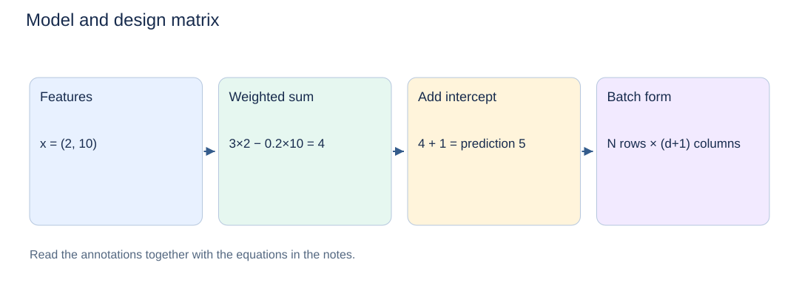
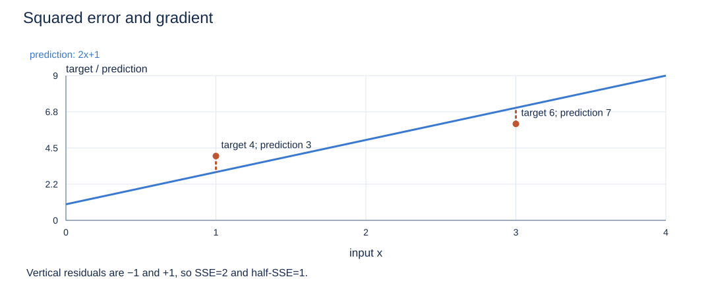
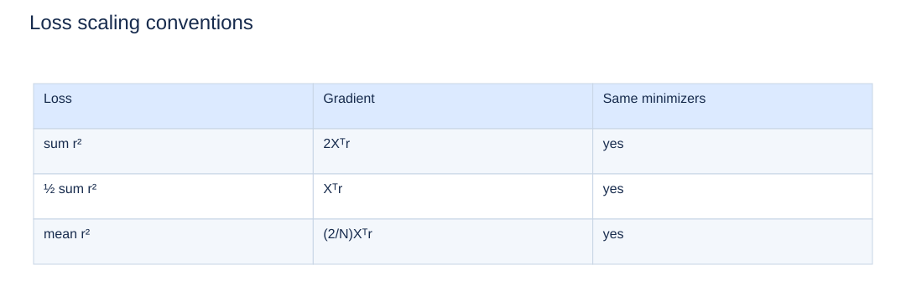
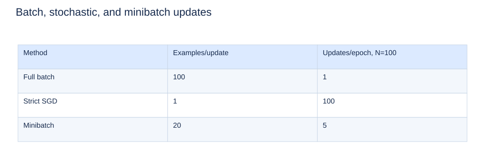

# 1.1 Linear Regression — Study Notes

**Provided Markdown:** [1.1_Linear_Regression.md](1.1_Linear_Regression.md). **Slides reviewed:** [COMP664_1_LinearRegresssion.pdf](COMP664_1_LinearRegresssion.pdf).

Starred entries preserve points and formulas from the provided Markdown; all teaching additions, examples, and source qualifications are unstarred. The provided Markdown is the available notes/transcript source; no separate verbatim transcript was found. Slide numbers refer to PDF page numbers, including title slides.

**Notation and prerequisites.** $\mathbb R$ denotes the real numbers. A vector stores several numbers; $x^\top$ is its transpose, $w^\top x=\sum_jw_jx_j$ is a dot product, and $\|v\|_2^2=\sum_jv_j^2$ is a squared Euclidean norm. $N$ counts examples and $d$ counts original features.

## Model and design matrix

**Sources:** Linear Regression, slides 4–9; provided Markdown section “Model and design matrix.”

★ For example $i$, let $x_i\in\mathbb R^d$ be its feature vector and $y_i\in\mathbb R$ its target.

★ Linear regression predicts $\hat y_i=w^\top x_i+b$.

★ The intercept $b$ can be absorbed into $w$ by adding a constant feature equal to one.

★ For example, a model could predict energy consumption from floor area, outdoor temperature, and last month's consumption.

A **feature** is a numerical input, a **target** is the measured value to predict, and a **parameter** is a number fitted from training data. For one house with features $x=(2,10)$, parameters $w=(3,-0.2)$, and intercept $b=1$, the prediction is $3(2)-0.2(10)+1=5$. The units of a coefficient must convert that feature's units into target units.

★ With examples as rows, $X\in\mathbb R^{N\times d}$, $w\in\mathbb R^d$, and $\hat y=Xw\in\mathbb R^N$, using the convention that the intercept is already included if needed.

For $N$ examples, stack $x_i^\top$ as rows. If there are $d$ original features, $X$ has $d$ columns before including an intercept and $d+1$ afterward. The augmented notation is $X'=[X\;\mathbf1]$, $w'=(w^\top,b)^\top$, so $X'w'=Xw+b\mathbf1$. This resolves the apparent change in dimension when the bias is absorbed. “Linear regression” with a nonzero intercept is technically affine in the original inputs. Slide 9 uses “perceptron” loosely for a single neuron; a classical perceptron uses a threshold for classification.

*Follow one prediction from feature values to the intercept; the same operation applies to every row in a batch.*

## Squared error and gradient

**Sources:** Linear Regression, slides 11–17 and 23–27; provided Markdown section “Squared error and gradient.”

★ Define the sum of squared errors by

★ Supplied formula:

$$
L(w)=\sum_{i=1}^N(\hat y_i-y_i)^2=\|Xw-y\|_2^2.
$$

**Convention check.** Your sum of squared errors and its factor-of-two gradient are correct together. Slides 11–13 instead use half the sum, $L_{\mathrm{lecture}}=\tfrac12\|Xw-y\|^2$, whose gradient is $X^\top(Xw-y)$. Do not combine the half-sum loss with the unscaled-sum gradient.

★ The scalar and matrix forms of its gradient are

★ Supplied formula:

$$
\frac{\partial L}{\partial w_j}
=2\sum_i(\hat y_i-y_i)x_{ij}
$$

★ Supplied formula:

$$
\nabla_w L=2X^\top(Xw-y).
$$

To derive your gradient, write $r_i=\sum_jx_{ij}w_j-y_i$. Then $\partial(r_i^2)/\partial w_j=2r_ix_{ij}$ by the chain rule; summing over $i$ gives the stated formula. For $x=2$, $y=5$, $w=1$, $b=0$, the residual is $-3$, the squared loss is $9$, and $\partial L/\partial w=-12$. With $\eta=0.1$, one step gives $w=2.2$, prediction $4.4$, and loss $0.36$.

★ The gradient for each feature sums its values weighted by the signed prediction residual.

★ Mean squared error divides the loss and gradient by $N$.

★ Using a factor of $1/2$ cancels the factor of two in the derivative.

★ These scaling conventions have the same minimizers and change the effective gradient step size.

★ Squared error is convex in the linear weights.

The Hessian is $2X^\top X$. For any vector $v$, $v^\top(2X^\top X)v=2\|Xv\|^2\ge0$, proving convexity. Slide 14's “no local minima” should mean **no nonglobal local minima**: convex losses certainly can have minima. A unique least-squares solution requires full column rank. Under that assumption, setting the gradient to zero gives $w^*=(X^\top X)^{-1}X^\top y$ (slide 13). Otherwise minimizers need not be unique; a pseudoinverse selects one. This closed form is a derivation, not a recommendation to compute a matrix inverse numerically.

*The dashed vertical segments are residuals: squaring and summing them gives the loss.*

*Keep the loss multiplier and the gradient multiplier consistent.*

## Batch, stochastic, and minibatch updates

**Sources:** Linear Regression, slides 19–20 and 25–31; provided Markdown section “Batch, stochastic, and minibatch updates.”

★ For learning rate $\eta>0$, gradient descent takes the step $w\leftarrow w-\eta g$.

A **gradient** lists the loss's partial derivatives with respect to the parameters; its negative points in the direction of steepest local decrease under Euclidean distance. The learning rate controls how far to move. For a batch $B$ and per-example loss $\ell_i$, use $g_B=|B|^{-1}\sum_{i\in B}\nabla\ell_i$ to estimate the full **mean** gradient. Uniform sampling makes this estimate unbiased. To estimate the full sum gradient instead, multiply by $N$.

| Method | Examples used to compute $g$ per update |
| --- | --- |
| ★ Full-batch gradient descent | All training examples |
| ★ Stochastic gradient descent | One sampled example in the strict definition |
| ★ Minibatch SGD | A sampled group of examples |

★ For the mean loss, average the per-example gradients within the minibatch.

★ An epoch is a pass through the training data.

★ Batch size is a hyperparameter.

★ Smaller batches generally produce noisier gradient estimates and give more updates per epoch.

★ Minibatches let the model use vectorized computation while updating more often than full-batch training.

With $N=100$ and batch size $20$, one epoch normally has five updates, whereas full-batch training has one. Sampling with replacement need not visit every example in an epoch; “epoch” then often denotes $N$ draws. More frequent updates and noisier estimates are distinct effects. Training parameters are learned by updates; hyperparameters such as batch size and learning rate are chosen using validation performance, not the held-out test set. Smaller batches can help generalization but do not guarantee it.

*Compare update frequency for the same 100-example dataset as batch size changes.*

