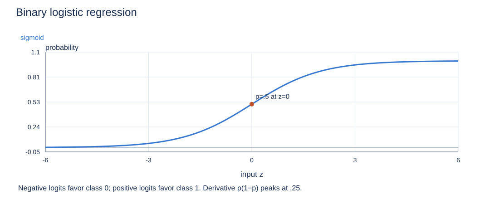
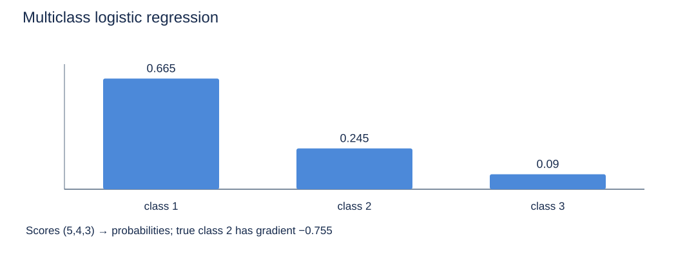
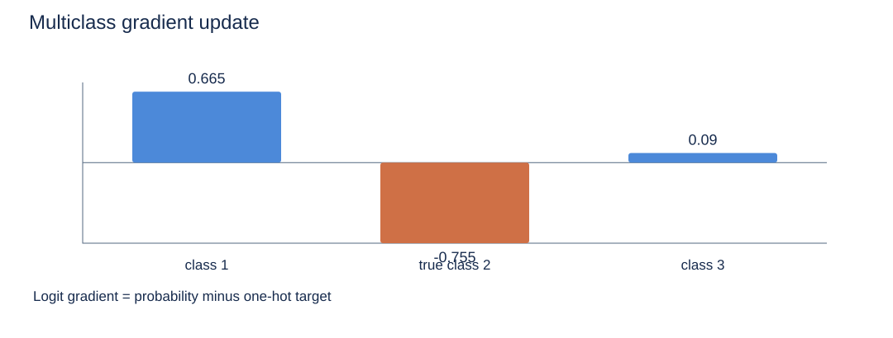

# 1.2 Logistic Regression — Study Notes

**Provided Markdown:** [1.2_Logistic_Regression.md](1.2_Logistic_Regression.md). **Slides reviewed:** [COMP664_2_LogisticRegression.pdf](COMP664_2_LogisticRegression.pdf).

Starred entries preserve points and formulas from the provided Markdown; all teaching additions, examples, and source qualifications are unstarred. The provided Markdown is the available notes/transcript source; no separate verbatim transcript was found. Slide numbers refer to PDF page numbers, including title slides.

**Notation and prerequisites.** $N$ is the number of labeled examples, $d$ is feature width, and $i$ indexes examples. A probability lies in $[0,1]$; all logarithms here are natural logarithms. $\partial$ denotes a partial derivative and $\nabla$ collects parameter derivatives into a gradient.

## Binary logistic regression

**Sources:** Logistic Regression, slides 10–25; provided Markdown section “Binary logistic regression.”

★ For features $x_i$ and label $y_i\in\{0,1\}$, the model defines a logit $z_i=w^\top x_i+b$ and a probability $p_i=\sigma(z_i)$, where

★ Supplied formula:

$$
\sigma(z)=\frac{1}{1+e^{-z}}.
$$

★ The probabilities of classes 1 and 0 are $p_i$ and $1-p_i$, respectively.

★ With a threshold of $0.5$, the decision boundary is $w^\top x_i+b=0$.

The **logit** is a real-valued score; it also equals the log odds: $\log[p/(1-p)]=z$. Thus increasing $z$ by one multiplies the odds by $e$. Sigmoid gives $\sigma(0)=1/2$, so thresholding at $1/2$ is equivalent to thresholding $z$ at zero. Other decision thresholds move this boundary.

★ Assuming conditionally independent examples, the likelihood is

★ Supplied formula:

$$
P(y\mid X,w,b)=\prod_{i=1}^N p_i^{y_i}(1-p_i)^{1-y_i}.
$$

★ Taking its negative logarithm gives binary cross-entropy:

★ Supplied formula:

$$
L=-\sum_{i=1}^N[y_i\log p_i+(1-y_i)\log(1-p_i)].
$$

The Bernoulli expression $p^y(1-p)^{1-y}$ selects $p$ when $y=1$ and $1-p$ when $y=0$. Independence conditional on inputs and parameters lets us multiply these terms across examples. The logarithm turns products into sums, and negation turns likelihood maximization into loss minimization.

★ Using $\sigma'(z_i)=p_i(1-p_i)$ gives $\partial L/\partial z_i=p_i-y_i$.

★ The weight and bias gradients are

★ Supplied formula:

$$
\frac{\partial L}{\partial w_j}=\sum_i(p_i-y_i)x_{ij}
$$

★ Supplied formula:

$$
\frac{\partial L}{\partial b}=\sum_i(p_i-y_i).
$$

★ For mean cross-entropy, divide both expressions by $N$.

★ The negative gradient uses $y_i-p_i$, which is the signed error in the direction of the update.

For one example, $\partial\ell/\partial p=-y/p+(1-y)/(1-p)=(p-y)/[p(1-p)]$. Multiplying by $\partial p/\partial z=p(1-p)$ cancels the denominator. Finally $\partial z/\partial w_j=x_j$ and $\partial z/\partial b=1$. If $y=1$ and $p=0.8$, the loss is $-\log 0.8\approx0.223$ and the logit gradient is $-0.2$; gradient descent increases the logit. Slides 24–25 maximize log likelihood by **ascent**; your notes minimize its negative by **descent**. Both have the same intended update direction.

*A zero logit maps to probability one-half; the tails show sigmoid saturation.*

## Multiclass logistic regression

**Sources:** Logistic Regression, slides 31–35; Backpropagation, chain-rule sections; provided Markdown section “Multiclass logistic regression.”

★ Give each of $C$ classes its own weight vector.

★ For example $i$, class $c$ has logit $s_{ic}=w_c^\top x_i+b_c$ and softmax probability

★ Supplied formula:

$$
p_{ic}=\frac{e^{s_{ic}}}{\sum_{k=1}^C e^{s_{ik}}}.
$$

Here $C$ is the number of mutually exclusive classes, and a one-hot target has one entry equal to one and all others zero. Softmax normalizes exponentials over **classes for one example**, not over examples. For $X\in\mathbb R^{N\times d}$, stacking weights as columns gives scores $S=XW+\mathbf1b^\top\in\mathbb R^{N\times C}$.

★ The probabilities sum to one across classes.

★ Scores $(5,4,3)$ yield approximately $(0.665,0.245,0.090)$.

★ Subtracting the largest score before exponentiating preserves the distribution and keeps the exponentials numerically stable.

For any scalar $a$, dividing numerator and denominator by $e^a$ proves $\operatorname{softmax}(s)=\operatorname{softmax}(s-a\mathbf1)$. Choosing $a=\max s$ makes all exponentials at most one. In actual implementations, compute cross-entropy from logits using log-sum-exp to avoid taking a logarithm of a probability rounded to zero.

★ With one-hot labels $y_{ic}$, multiclass cross-entropy is $L=-\sum_i\sum_c y_{ic}\log p_{ic}$.

★ Each example contributes $-\log p_{i,y_i}$, the negative log probability of its true class.

★ The logit gradient is $p_{ic}-y_{ic}$.

★ Section 1.4 derives this result from the softmax Jacobian.

For target class $c$, $\ell=-s_c+\log\sum_ke^{s_k}$. Differentiating directly gives $\partial\ell/\partial s_j=p_j-\mathbf1_{j=c}$. For the scores in your example and target class 2, the gradient is approximately $(0.665,-0.755,0.090)$. Subtracting this gradient raises the true class score relative to the others. Prediction can use $\arg\max_cs_c$ because exponentiation is increasing and the denominator is common. With two classes, $p_1=\sigma(s_1-s_0)$, recovering binary logistic regression.

*The three softmax probabilities sum to one, even though the input scores do not.*

*Subtracting the negative true-class gradient increases its logit.*

