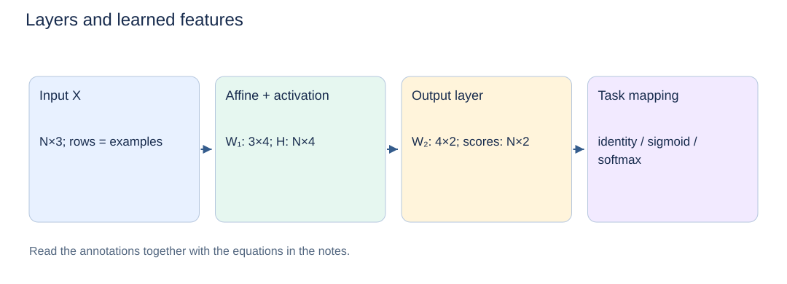
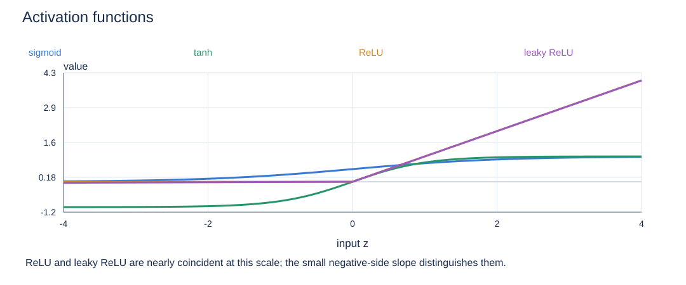
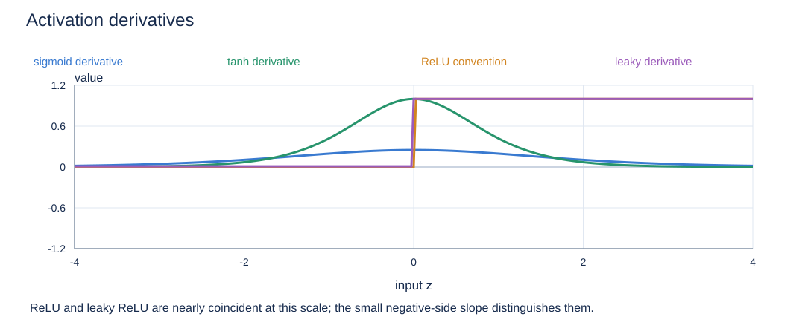
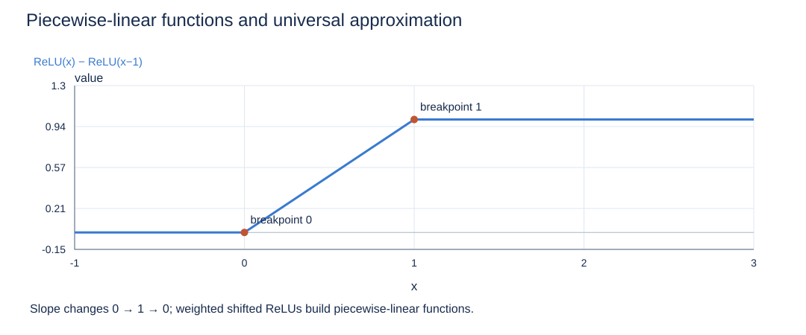

# 1.3 Feedforward Neural Networks — Study Notes

**Provided Markdown:** [1.3_Feedforward_Neural_Networks.md](1.3_Feedforward_Neural_Networks.md). **Slides reviewed:** [COMP664_3_FFNs.pdf](COMP664_3_FFNs.pdf).

Starred entries preserve points and formulas from the provided Markdown; all teaching additions, examples, and source qualifications are unstarred. The provided Markdown is the available notes/transcript source; no separate verbatim transcript was found. Slide numbers refer to PDF page numbers, including title slides.

**Notation and prerequisites.** Rows of $X$ represent examples; $N$ is the batch size, $d$ is input width, $h$ is hidden width, and $C$ is output width. A matrix product combines features; an elementwise function acts independently on each entry.

## Layers and learned features

**Sources:** Feedforward Networks, slides 4–15; provided Markdown section “Layers and learned features.”

★ A feedforward neural network passes an input through a sequence of layers to produce an output.

★ A fully connected feedforward network is commonly called a multilayer perceptron (MLP).

★ Its hidden layers learn intermediate features.

★ Linear regression can be viewed as a one-layer network with a linear output.

★ For a two-layer MLP with examples as rows,

★ Supplied formula:

$$
H=\phi(XW_1+b_1)
$$

★ Supplied formula:

$$
\hat Y=g(HW_2+b_2).
$$

★ Here $\phi$ is an elementwise hidden activation and $g$ depends on the task.

★ A real-valued regression output can use the identity, binary classification can use sigmoid, and multiclass classification can use softmax.

★ If $X$ has shape $N\times3$ and $W_1$ has shape $3\times4$, then $H$ has shape $N\times4$.

★ Each row represents one example and each column represents one hidden unit.

For input width $d$, hidden width $h$, and output width $C$, row-vector notation uses $W_1\in\mathbb R^{d\times h}$, $b_1\in\mathbb R^h$, $W_2\in\mathbb R^{h\times C}$, and $b_2\in\mathbb R^C$. Each bias is broadcast over rows. A two-layer network counts two learned weight transformations, excluding the input layer; with dimensions $3\to4\to2$, it has $(3\cdot4+4)+(4\cdot2+2)=26$ parameters.

★ Stacking linear transformations alone gives $XW_1W_2=XW'$.

★ Adding biases still gives a single affine transformation.

★ Hidden nonlinearities allow the network to learn more expressive functions and reduce the need to design nonlinear input features by hand.

Without a hidden nonlinearity, $(XW_1+\mathbf1b_1^\top)W_2+\mathbf1b_2^\top=X(W_1W_2)+\mathbf1(b_1^\top W_2+b_2^\top)$. Depth then changes the parameterization but not the family of affine input–output maps. An output sigmoid alone still gives a linear decision boundary in the input features. Hidden nonlinearities let the slope or decision behavior change across input regions. Hidden units are learned features because training adjusts which combinations of inputs activate them.

*Track the matrix dimensions through the hidden layer and task-dependent output.*

## Activation functions

**Sources:** Feedforward Networks, slides 17–21; provided Markdown section “Activation functions.”

| Activation | Function | Derivative |
| --- | --- | --- |
| ★ Sigmoid | $\sigma(z)=1/(1+e^{-z})$ | $\sigma(z)(1-\sigma(z))$ |
| ★ Tanh | $\tanh(z)=(e^z-e^{-z})/(e^z+e^{-z})$ | $1-\tanh^2(z)$ |
| ★ ReLU | $\max(0,z)$ | $0$ for $z<0$, $1$ for $z>0$ |
| ★ Leaky ReLU | $\max(0.01z,z)$ | $0.01$ for $z<0$, $1$ for $z>0$ |

Differentiate sigmoid by writing $(1+e^{-z})^{-1}$: the result is $e^{-z}/(1+e^{-z})^2=\sigma(z)(1-\sigma(z))$. Its maximum derivative is $1/4$, reached at zero. Tanh is zero-centered and has derivative one at zero, but both tails saturate. A saturated unit can pass a meaningful activation forward while sending a very small derivative backward.

★ Sigmoid maps to $(0,1)$ and tanh maps to $(-1,1)$.

★ Both saturate for large-magnitude inputs, where derivatives become small.

★ ReLU passes positive inputs through and sets negative inputs to zero.

★ Leaky ReLU retains a small gradient on the negative side.

★ At the kink at zero, implementations choose a derivative convention.

For ReLU, the derivative at zero is mathematically undefined. Slide 19 selects one at zero, whereas many implementations select zero; neither makes the ordinary derivative exist. Your notes correctly distinguish a convention from a derivative. A “dead” ReLU stays nonpositive across the relevant inputs and gets no gradient through its activation. Leaky ReLU keeps a nonzero slope there. The slides' approximate training-speed comparisons are empirical illustrations, not universal speed guarantees; shared upstream weights can also change a unit's inputs.

*Compare the ranges and shapes: sigmoid and tanh saturate, while ReLU passes positive inputs.*

*Compare derivatives: sigmoid and tanh saturate, while active ReLU has slope one.*

## Piecewise-linear functions and universal approximation

**Sources:** Feedforward Networks, slides 22–24; provided Markdown section “Piecewise-linear functions and universal approximation.”

★ A shifted ReLU $\operatorname{ReLU}(x-b)$ introduces a breakpoint at $b$.

★ Multiplying it by $a$ changes the slope by $a$ at the breakpoint.

★ For example,

★ Supplied formula:

$$
\operatorname{ReLU}(x)-\operatorname{ReLU}(x-1)
$$

★ is zero for $x\le 0$, ramps linearly from zero to one on $[0,1]$, and stays at one for $x\ge1$.

★ Combining shifted ReLUs lets a hidden layer approximate a continuous one-dimensional curve with piecewise-linear segments.

Evaluate the ramp example by regions. For $x\le0$ both ReLUs are zero. For $0<x<1$, only the first is active, giving $x$. For $x\ge1$, both are active and the difference is $x-(x-1)=1$. A useful general form is $f(x)=a_0+a_1x+\sum_jc_j\operatorname{ReLU}(x-b_j)$: each $b_j$ is a breakpoint and each $c_j$ is a change in slope.

★ Under the universal approximation theorem's conditions, a network with one sufficiently wide hidden layer and a suitable nonlinear activation can approximate continuous functions on compact domains arbitrarily closely.

★ This is a statement about representational capacity.

★ Finding the weights and generalizing to unseen data are separate problems.

A precise common approximation statement is: for any continuous target $f$ on a compact set $K\subset\mathbb R^d$ and any tolerance $\varepsilon>0$, a sufficiently wide one-hidden-layer network with a suitable activation (including ReLU) has parameters satisfying $\sup_{x\in K}|f(x)-\hat f(x)|<\varepsilon$. Width may depend on the target and tolerance. Slide 23's “any function” needs these domain, function-class, activation, and error-measure qualifications. The theorem gives existence, not a training algorithm or a sample-complexity guarantee. Backpropagation computes gradients; the optimizer uses them to search for parameters.

*Two shifted ReLUs create a ramp with slope changes at zero and one.*

