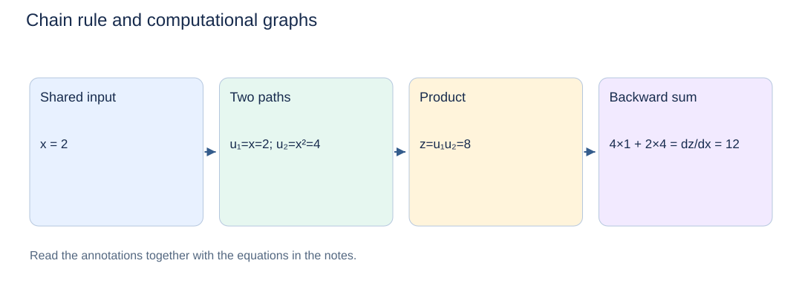
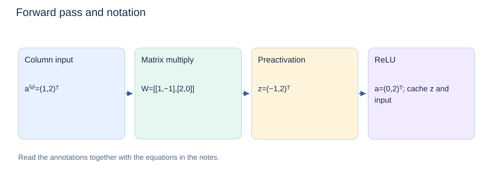
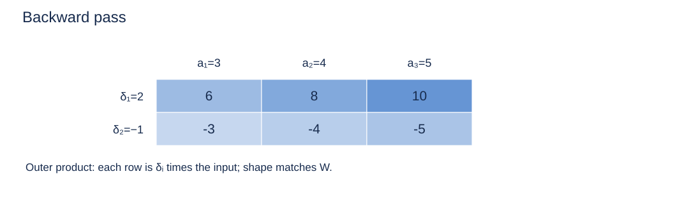
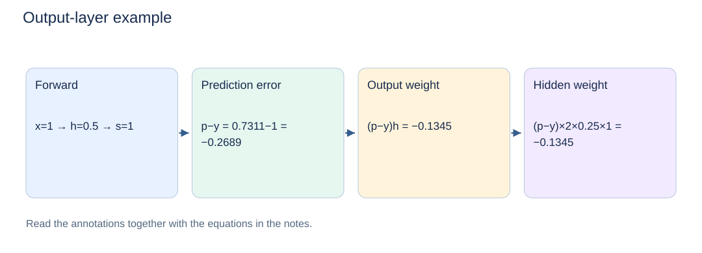
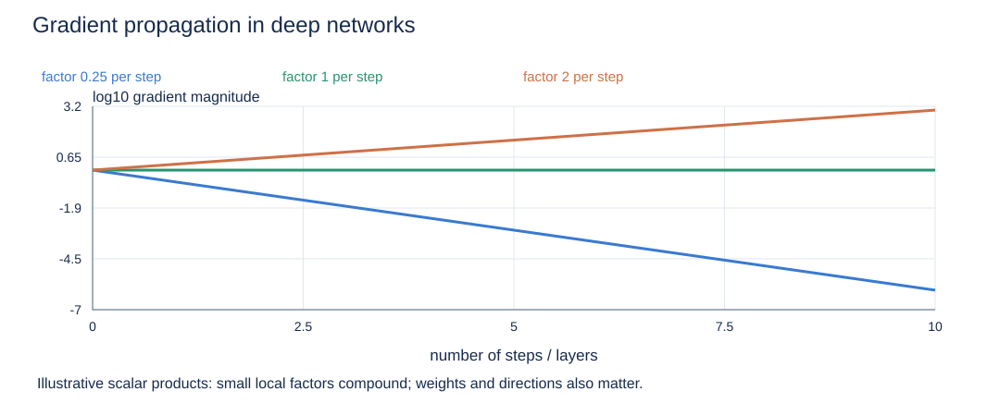

# 1.4 Backpropagation — Study Notes

**Provided Markdown:** [1.4_Backpropagation.md](1.4_Backpropagation.md). **Slides reviewed:** [COMP664_4_Backpropagation.pdf](COMP664_4_Backpropagation.pdf).

Starred entries preserve points and formulas from the provided Markdown; all teaching additions, examples, and source qualifications are unstarred. The provided Markdown is the available notes/transcript source; no separate verbatim transcript was found. Slide numbers refer to PDF page numbers, including title slides.

**Notation and prerequisites.** $L$ denotes scalar loss and $\ell$ indexes a layer. Superscripts in parentheses identify layers, not powers. A Jacobian stores the partial derivatives of a vector-valued function. The forward pass computes values; the backward pass computes derivatives.

## Chain rule and computational graphs

**Sources:** Backpropagation, slides 4–5; provided Markdown section “Chain rule and computational graphs.”

★ If $z$ depends on $x$ through intermediate values $u_1,\ldots,u_m$, then

★ Supplied formula:

$$
\frac{dz}{dx}=\sum_{k=1}^m\frac{\partial z}{\partial u_k}\frac{du_k}{dx}.
$$

A computational graph stores intermediate operations as nodes. The multivariable chain rule assumes differentiability at the point considered, with subgradient conventions used for nonsmooth activations. For $u_1=x$, $u_2=x^2$, and $z=u_1u_2$, the two path contributions are $u_2\cdot1=x^2$ and $u_1\cdot2x=2x^2$, giving $dz/dx=3x^2$. Ignoring either path is wrong.

★ Multiply derivatives along each path and add the contributions of all paths.

★ Backpropagation applies this rule from the loss toward the inputs and reuses gradients at shared intermediate nodes.

Reverse-mode differentiation starts the scalar loss gradient at one and accumulates incoming contributions at every shared node. Once a node's total incoming gradient is known, multiply by its local derivatives to continue backward. Reusing saved values avoids recomputing every complete path separately.

*Both routes from x contribute to the derivative of the shared output.*

## Forward pass and notation

**Sources:** Backpropagation, slides 7–8; provided Markdown section “Forward pass and notation.”

★ Use a column vector $a^{(0)}=x$ for one example.

★ For layer $\ell$,

★ Supplied formula:

$$
z^{(\ell)}=W^{(\ell)}a^{(\ell-1)}+b^{(\ell)}
$$

★ Supplied formula:

$$
a^{(\ell)}=\phi_\ell(z^{(\ell)}).
$$

This lecture uses **column vectors**, unlike the batch-row notation in lecture 1.3. If the preceding layer has $n_{\ell-1}$ units and the current layer has $n_\ell$, multiplication must be $(n_\ell\times n_{\ell-1})(n_{\ell-1}\times1)$. Both $z^{(\ell)}$ and $a^{(\ell)}$ have $n_\ell$ entries. This is a convention change, not a disagreement about the model.

★ The preactivation $z^{(\ell)}$ comes before the activation function.

★ The postactivation $a^{(\ell)}$ is passed to the next layer.

★ With $n_\ell$ units in layer $\ell$, the weight matrix $W^{(\ell)}$ is $n_\ell\times n_{\ell-1}$.

★ Save the values needed for local derivatives during the forward pass.

For $x=(1,2)^\top$, $W=\begin{bmatrix}1&-1\\2&0\end{bmatrix}$, and $b=0$, the preactivation is $(-1,2)^\top$. ReLU then gives $(0,2)^\top$. Save the previous activations for weight gradients and enough information to compute activation derivatives (for ReLU, the preactivation's sign). Compute every gradient at the same parameter values before the optimizer updates weights.

*The preactivation can be negative even when ReLU sets the resulting activation to zero.*

## Backward pass

**Sources:** Backpropagation, slides 9–13; provided Markdown section “Backward pass.”

★ Let $\delta^{(\ell)}=\partial L/\partial z^{(\ell)}$.

★ For hidden layers with elementwise activation,

★ Supplied formula:

$$
\delta^{(\ell)}
=\left((W^{(\ell+1)})^\top\delta^{(\ell+1)}\right)
 \odot \phi_\ell'(z^{(\ell)}).
$$

The symbol $\odot$ means multiplication of matching coordinates; it is not a matrix product. Set the output error using the actual loss and output activation, then iterate backward. Coordinatewise, $\delta_i^{(\ell)}=\phi_\ell'(z_i^{(\ell)})\sum_kW_{ki}^{(\ell+1)}\delta_k^{(\ell+1)}$. The sum collects every outgoing path from hidden unit $i$.

★ The transpose collects the weighted gradient contributions from the next layer.

★ The elementwise product multiplies each by the local activation derivative.

★ The parameter gradients are

★ Supplied formula:

$$
\frac{\partial L}{\partial W^{(\ell)}}=
\delta^{(\ell)}(a^{(\ell-1)})^\top
$$

★ Supplied formula:

$$
\frac{\partial L}{\partial b^{(\ell)}}=\delta^{(\ell)}.
$$

★ For weight $W^{(\ell)}_{ij}$, the gradient is the preactivation gradient at unit $i$ times the previous-layer activation at unit $j$.

★ The weight gradient is an outer product with the same shape as $W^{(\ell)}$.

★ Sum or average per-example contributions according to the definition of the batch loss.

★ The optimizer uses these gradients to update parameters.

The affine operation has $\partial z_i/\partial W_{ij}=a_j^{(\ell-1)}$, explaining the outer product. If $\delta=(2,-1)^\top$ and $a=(3,4,5)^\top$, then $\partial L/\partial W=\begin{bmatrix}6&8&10\\-3&-4&-5\end{bmatrix}$ and $\partial L/\partial b=(2,-1)^\top$. A bias gets one contribution per example, so its batch gradient also sums or averages over examples. The elementwise-activation recursion does not apply unchanged to a coupled softmax; use its Jacobian or the combined softmax–cross-entropy simplification.

*Every gradient entry is the product of one error coordinate and one saved input coordinate.*

## Output-layer example

**Sources:** Backpropagation, slides 15–17; Logistic Regression, slides 33–34; provided Markdown section “Output-layer example.”

★ With softmax probabilities $p_i$, logits $s_j$, and one-hot targets $y_i$,

★ Supplied formula:

$$
\frac{\partial p_i}{\partial s_j}=p_i(\mathbf1_{i=j}-p_j)
$$

★ Supplied formula:

$$
\frac{\partial L}{\partial p_i}=-\frac{y_i}{p_i}.
$$

★ Summing the product over $i$ gives $\partial L/\partial s_j=p_j-y_j$.

★ With binary sigmoid and cross-entropy, the same prediction-minus-target form holds for the single logit.

For one-hot labels $\sum_iy_i=1$. Applying the chain rule to the softmax Jacobian gives

$$\frac{\partial L}{\partial s_j}=\sum_i\left(-\frac{y_i}{p_i}\right)p_i(\mathbf1_{i=j}-p_j)=-y_j+p_j\sum_iy_i=p_j-y_j.$$

★ For a scalar hidden unit $h=\sigma(w_1x)$, output logit $s=w_2h$, and prediction $p=\sigma(s)$, binary cross-entropy gives

★ Supplied formula:

$$
\frac{\partial L}{\partial w_2}=(p-y)h
$$

★ Supplied formula:

$$
\frac{\partial L}{\partial w_1}=(p-y)w_2h(1-h)x.
$$

The cancellation is specific to the paired output activation and loss. Squared error applied after sigmoid retains an extra sigmoid derivative. For your scalar hidden-unit example, take $x=1$, $w_1=0$, $w_2=2$, $y=1$. Then $h=0.5$, $s=1$, $p\approx0.7311$, $\partial L/\partial w_2\approx-0.1345$, and $\partial L/\partial w_1\approx-0.1345$. The second gradient follows four local factors: prediction error, outgoing weight, hidden sigmoid derivative, and input.

*Trace the prediction-minus-target error through the output and hidden weight derivatives.*

## Gradient propagation in deep networks

**Sources:** Backpropagation, slides 19–23; provided Markdown section “Gradient propagation in deep networks.”

★ Repeated chain-rule multiplication can make gradients small or large as they travel through many layers.

★ Sigmoid's derivative is at most $1/4$ and becomes smaller in its saturated regions.

★ This can contribute to vanishing gradients in deep sigmoid networks.

★ Weight matrices also affect the size of the gradient at each step.

A gradient crossing $k$ layers contains a product of local Jacobians. If their operator norms are each at most $c<1$, its norm is bounded by $c^k$ times the incoming norm. For illustration, ten factors of $1/4$ give $4^{-10}\approx9.54\times10^{-7}$. Conversely, a repeatedly amplified direction can explode. Activation derivatives alone do not determine this: weight matrices, directions, and the data all matter.

The lecture lists complementary mitigations: ReLU-family activations preserve derivatives on active paths; suitable initialization controls early signal scales; normalization controls activation scales; and residual paths add identity terms. Gradient clipping replaces a gradient $g$ by $g\min(1,\tau/\|g\|_2)$ for a positive threshold $\tau$ (with zero handled separately). This limits exploding update magnitudes but cannot restore a gradient that already vanished.

*On the logarithmic vertical scale, repeated contraction or expansion becomes a straight line.*

