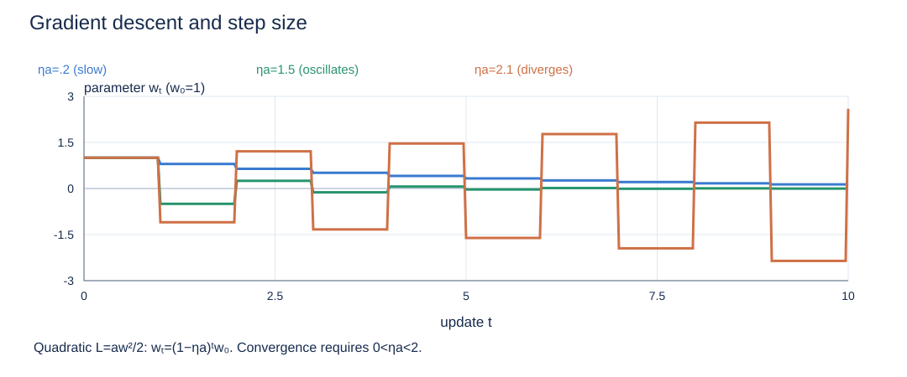
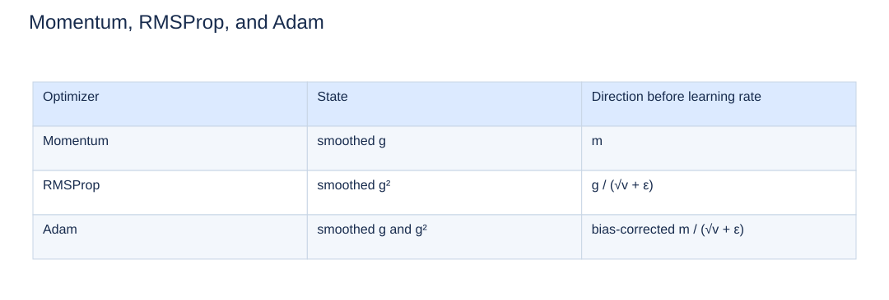
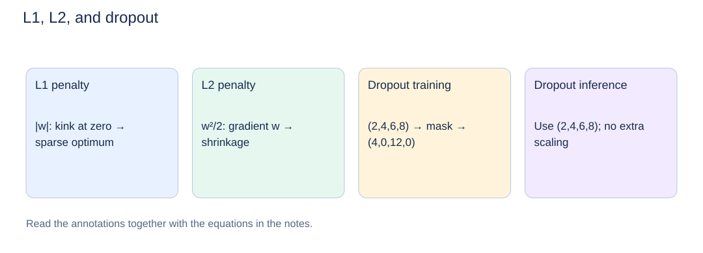
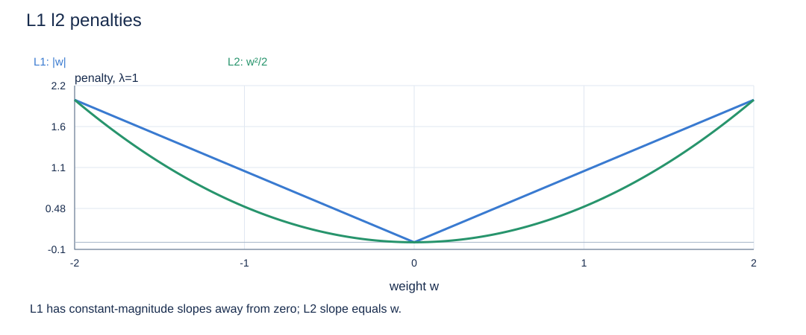

# 1.5 Learning Rates and Regularization — Study Notes

**Provided Markdown:** [1.5_Learning_Rates_and_Regularization.md](1.5_Learning_Rates_and_Regularization.md). **Slides reviewed:** [COMP664_5_LearningRatesAndDropout.pdf](COMP664_5_LearningRatesAndDropout.pdf).

Starred entries preserve points and formulas from the provided Markdown; all teaching additions, examples, and source qualifications are unstarred. The provided Markdown is the available notes/transcript source; no separate verbatim transcript was found. Slide numbers refer to PDF page numbers, including title slides.

**Notation and prerequisites.** $\theta$ collects trainable parameters, $L$ is a scalar loss, $t$ indexes optimizer updates, and $\eta>0$ is the learning rate. A gradient gives local loss sensitivity. An expectation is a probability-weighted average, while a variance measures centered squared deviation.

## Gradient descent and step size

**Sources:** Adaptive Learning Rates, slides 4–6; provided Markdown section “Gradient descent and step size.”

★ For a smooth objective $L(\theta)$, the first-order Taylor approximation gives

★ Supplied formula:

$$
L(\theta+\Delta)\approx L(\theta)+\nabla L(\theta)^\top\Delta.
$$

The Taylor approximation assumes differentiability and is reliable only locally. If the gradient is $M$-Lipschitz, meaning $\|\nabla L(u)-\nabla L(v)\|_2\le M\|u-v\|_2$ for the points considered, then $L(\theta-\eta g)\le L(\theta)-\eta(1-M\eta/2)\|g\|^2$ for $g=\nabla L(\theta)$, so $0<\eta<2/M$ guarantees descent when $g\ne0$. This deterministic guarantee does not apply to every minibatch step, since a sampled gradient is noisy.

★ Taking $\Delta=-\eta\nabla L(\theta)$ gives a first-order change of $-\eta\|\nabla L(\theta)\|^2$.

★ For a nonzero gradient and a sufficiently small positive learning rate $\eta$, this is a descent step.

★ A very small learning rate makes progress slow.

★ A very large learning rate can overshoot, oscillate, or diverge.

★ For $L(w)=\tfrac12 aw^2$ with $a>0$, the update is $w_{t+1}=(1-\eta a)w_t$.

★ It converges when $0<\eta a<2$ and oscillates while converging when $1<\eta a<2$.

★ A schedule can reduce the step size as training progresses.

For the quadratic example, iterate to get $w_t=(1-\eta a)^tw_0$. Convergence to zero requires $|1-\eta a|<1$. At $\eta a=1$, it reaches zero in one step; at $\eta a=2$ it alternates without decreasing magnitude (unless initialized at zero); above two it diverges. A decreasing schedule can help refine a solution but cannot substitute for checking the loss and validation behavior.

*A larger step can alternate in sign yet converge, or cross the stability threshold and diverge.*

## Momentum, RMSProp, and Adam

**Sources:** Adaptive Learning Rates, slides 8–12; provided Markdown section “Momentum, RMSProp, and Adam.”

★ Let $g_t=\nabla L_t(\theta_{t-1})$ be the current minibatch gradient.

All squares, roots, and divisions in these optimizer formulas are elementwise. The symbol $t$ counts updates, $\theta$ collects the trainable parameters, and decay rates lie in $[0,1)$. Initialize moment accumulators to zero. Unrolling $m_t$ gives $(1-\beta)\sum_{s=1}^t\beta^{t-s}g_s$, so recent gradients have more influence.

★ **Momentum** accumulates recent gradients.

★ One convention is $m_t=\beta m_{t-1}+(1-\beta)g_t$, followed by $\theta_t=\theta_{t-1}-\eta m_t$.

★ The contributions of older gradients decay geometrically.

★ In a narrow valley, opposing gradients across the steep direction can partly cancel while consistent gradients along the valley accumulate.

**Momentum convention.** Slide 8 uses $v_t=\beta v_{t-1}+\eta g_t$, $\theta_t=\theta_{t-1}-v_t$. Your exponential-average convention is also valid, but using the same numerical learning rate does not give identical updates. For constant learning rates, matching them requires $\eta_{\mathrm{slide}}=(1-\beta)\eta_{\mathrm{notes}}$. With varying rates, the placement of the rate inside or outside the accumulator also matters.

★ **RMSProp** tracks recent squared gradients elementwise:

★ Supplied formula:

$$
v_t=\beta v_{t-1}+(1-\beta)g_t^2
$$

★ Supplied formula:

$$
\theta_t=\theta_{t-1}-\eta\,\frac{g_t}{\sqrt{v_t}+\epsilon}.
$$

★ Coordinates with larger recent squared gradients receive more scaling.

★ The $\epsilon$ term prevents division by zero.

★ The running average estimates an uncentered second moment.

★ **Adam** combines the moving average of gradients with the moving average of squared gradients.

★ Starting both at zero, with decay rates $\beta_1$ and $\beta_2$,

★ Supplied formula:

$$
m_t=\beta_1 m_{t-1}+(1-\beta_1)g_t
$$

★ Supplied formula:

$$
v_t=\beta_2 v_{t-1}+(1-\beta_2)g_t^2.
$$

★ Use bias corrections $\hat m_t=m_t/(1-\beta_1^t)$ and $\hat v_t=v_t/(1-\beta_2^t)$, then update by $-\eta\hat m_t/(\sqrt{\hat v_t}+\epsilon)$.

★ The corrections compensate for zero initialization, especially early in training.

**Second moment is not variance.** RMSProp and Adam track $E[g^2]$, not $E[(g-E[g])^2]$. Adam divides a smoothed first moment by a smoothed root second moment; it does not force the gradients to zero mean or unit variance, despite slide 11's informal wording. If the first gradient is $g_1=2$, $\beta_1=0.9$, and $\beta_2=0.999$, then $m_1=0.2$, $v_1=0.004$, $\hat m_1=2$, and $\hat v_1=4$. The bias-corrected first update is approximately $-\eta$; using the uncorrected ratio instead would give $-\eta(0.2/\sqrt{0.004})\approx-3.162\eta$. Epsilon placement varies by convention; keep the selected expression consistent.

*Compare what each optimizer remembers and how that state changes the update direction.*

## L1, L2, and dropout

**Sources:** Adaptive Learning Rates, slides 15–17; Linear Regression, slides 15–17; provided Markdown section “L1, L2, and dropout.”

★ Regularization can reduce overfitting by changing the objective or the training procedure.

★ **L1** adds $\lambda\sum_j|w_j|$ to the loss.

★ Its kink at zero promotes sparse weights.

★ Away from zero, the penalty gradient is $\lambda\operatorname{sign}(w_j)$.

★ At zero, the penalty admits a range of subgradients.

★ **L2** adds $\frac{\lambda}{2}\sum_j w_j^2$, contributing $\lambda w_j$ to the gradient.

★ This shrinks weights, with a larger penalty gradient for larger weights.

★ **Dropout** randomly zeros selected activations during training.

★ For drop probability $p$, inverted dropout computes $\tilde h=(m\odot h)/(1-p)$, where the entries of $m$ are sampled with keep probability $1-p$.

★ The scaling preserves the activation in expectation.

★ During backpropagation, masked activations receive zero gradient through that path.

★ At inference, inverted dropout uses the full activations directly.

★ Training with masks encourages predictions to be less dependent on any one hidden feature.

The regularization strength $\lambda\ge0$ trades training fit against the penalty. L1's subgradient at zero is $[-\lambda,\lambda]$; sparsity is a property of the penalized solution, and ordinary finite-step gradient descent need not make weights exactly zero. With L2 and plain SGD, $w\leftarrow(1-\eta\lambda)w-\eta\nabla L_{\mathrm{data}}$. This coupled L2 penalty is not generally equivalent to decoupled weight decay under adaptive optimizers.

For dropout, $0\le p<1$ and each mask entry is Bernoulli with success probability $1-p$. Conditional on an activation $h_j$, $E[m_jh_j/(1-p)]=h_j$. For $p=1/2$ and $h=(2,4,6,8)$, mask $(1,0,1,0)$ gives $(4,0,12,0)$. The backward multiplier is $m_j/(1-p)$ as well. Preserving activation expectations does not make the expected output of a nonlinear network identical to its inference output.

**Slide discrepancy resolved.** Slide 15 already scales retained activations during training, which is inverted dropout. Slide 16 additionally says to scale weights by $p$ at test time; that conflicts with slide 15 and its definition of $p$ as drop probability. Use your notes' inference rule: no dropout and no extra scaling. With the alternative unscaled-training convention, test-time scaling would use the **keep** probability $1-p$.

*L1 and L2 modify the objective; inverted dropout masks and rescales activations during training.*

*L1 has a kink at zero; L2 is smooth and its slope grows with weight magnitude.*

