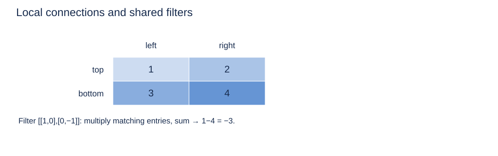
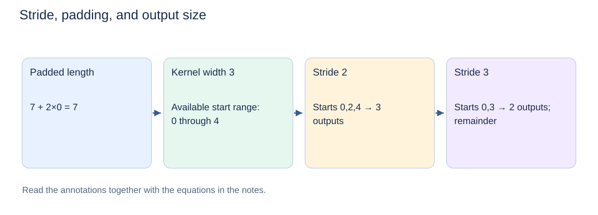
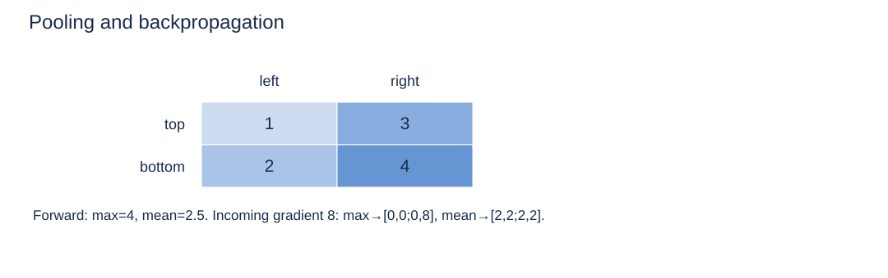
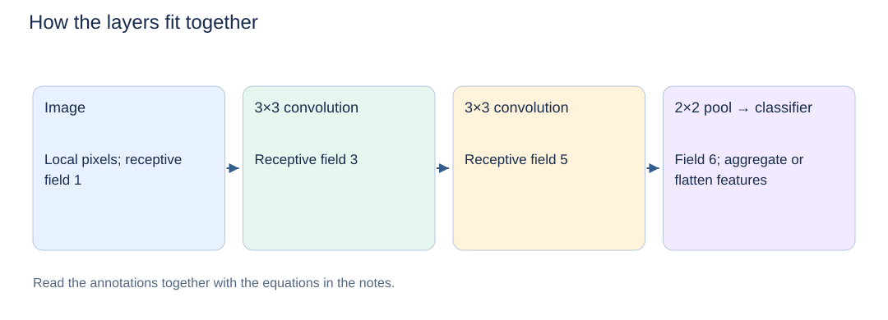

# 1.6 Convolutional Neural Networks — Study Notes

**Provided Markdown:** [1.6_Convolutional_Neural_Networks.md](1.6_Convolutional_Neural_Networks.md). **Slides reviewed:** [COMP664_6_CNNs.pdf](COMP664_6_CNNs.pdf).

Starred entries preserve points and formulas from the provided Markdown; all teaching additions, examples, and source qualifications are unstarred. The provided Markdown is the available notes/transcript source; no separate verbatim transcript was found. Slide numbers refer to PDF page numbers, including title slides.

**Notation and prerequisites.** An image is an array of height $H$, width $W$, and $C$ channels. A filter is a learned array used in a sliding dot product. Spatial positions are different from channels, and neither is an extra learned parameter by itself.

## Local connections and shared filters

**Sources:** Convolutional Neural Networks, slides 4–15; provided Markdown section “Local connections and shared filters.”

★ A convolutional layer applies each learned filter at many spatial locations.

★ A filter uses a local patch and spans the input channels.

★ One filter produces one feature map.

★ For input shape $H\times W\times C_{\mathrm{in}}$, $C_{\mathrm{out}}$ filters of spatial size $K_h\times K_w$ produce $C_{\mathrm{out}}$ output channels and use $K_hK_wC_{\mathrm{in}}C_{\mathrm{out}}$ weights, plus one bias per output channel if used.

★ The parameter count is independent of the number of spatial locations because the weights are shared.

A dense layer connecting a $1024\times1024\times3$ image to 100 units needs $314{,}572{,}800$ weights. A convolutional layer with 100 filters of shape $3\times3\times3$ needs only $2{,}700$ weights, plus 100 biases. The same filter weights are reused at every valid spatial position; the many output activations are not additional parameters.

★ Each output value is a dot product between the corresponding patch and filter, plus its bias.

★ Deep learning libraries commonly implement this operation as cross-correlation, applying the filter without flipping it.

★ Moving a pattern in the input can move its activation in the output.

★ This is translation equivariance, subject to boundary and stride effects.

For one input channel, a patch $\begin{bmatrix}1&2\\3&4\end{bmatrix}$ and filter $\begin{bmatrix}1&0\\0&-1\end{bmatrix}$ give $1-4=-3$ before bias and activation. Multiple input channels contribute sums to the same output scalar. Multiple filters produce separate output channels. A convolution can detect an edge wherever it appears: its response **moves with** the edge. This is equivariance, not global invariance. Classification may gain approximate invariance by later pooling or aggregation. Boundary padding and subsampling limit exact equivariance.

*Apply the annotated filter to this patch: matching products sum to a single output scalar.*

## Stride, padding, and output size

**Sources:** Convolutional Neural Networks, slides 20–24; provided Markdown section “Stride, padding, and output size.”

★ Stride controls how far the filter moves between successive positions.

★ Padding adds values around the boundary, often zeros.

★ With symmetric padding $P$, kernel width $K$, stride $S$, and unit dilation, apply the formula separately to each spatial axis:

★ Supplied formula:

$$
D_{\mathrm{out}}=\left\lfloor\frac{D_{\mathrm{in}}+2P-K}{S}\right\rfloor+1.
$$

The left edge of a valid filter window can start at $0,S,2S,\ldots$ while its right edge remains within the padded input. Thus the largest start index satisfies $jS\le D_{\mathrm{in}}+2P-K$, giving the floor formula in your notes. Assume a positive integer stride, nonnegative integer padding, and at least one fitting window. With dilation $D$, replace $K$ by the effective width $D(K-1)+1$.

★ For example, $D_{\mathrm{in}}=32$, $K=3$, $P=1$, and $S=1$ yield an output size of $32$.

★ Increasing the stride to $2$ yields $16$.

★ The output depth comes from the number of filters.

**Slide clarification.** Slide 21 asks why stride 3 cannot be applied to a width-7 input with width-3 kernel. It can be applied under the floor convention: starts 0 and 3 produce two outputs and leave one trailing input position unused. The slide appears to require exact tiling with no remainder; its formula omits the floor. Your formula is the general window-count convention. Keeping the same size with odd $K$ and stride one uses $P=(K-1)/2$; stride greater than one generally downsamples even with padding.

*Count valid window starts; stride three leaves a remainder but still produces two outputs.*

## Pooling and backpropagation

**Sources:** Convolutional Neural Networks, slides 16 and 24; source section “Pooling and backpropagation”; provided Markdown section “Pooling and backpropagation.”

★ Max pooling reports the largest activation in each window.

★ Average pooling reports the mean.

★ Pooling usually reduces spatial dimensions without introducing learned weights and can make features less sensitive to small shifts within a window.

For the window $\begin{bmatrix}1&3\\2&4\end{bmatrix}$, max pooling gives $4$ and average pooling gives $2.5$. If the outgoing loss gradient is $8$, max pooling sends $8$ only to the bottom-right entry, while average pooling sends $2$ to each entry. If pooling windows overlap, an input accumulates contributions from every window containing it. Tie handling for maxima is an implementation choice.

★ During backpropagation, a max-pooling window sends its gradient to the input selected as the maximum in the forward pass, using the implementation's tie convention.

★ Average pooling distributes the gradient evenly across the window.

★ A convolutional filter receives gradient contributions from every output location where it was used.

★ Backpropagation sums those contributions for each shared weight.

For a shared convolutional weight $w$, let output at location $r$ contain the term $wx_r$. The chain rule gives $\partial L/\partial w=\sum_r(\partial L/\partial z_r)x_r$, where $z_r$ is the preactivation. Weight sharing therefore means summing gradients, not learning a separate filter at each location. Pooling preserves channel count when applied independently to each channel. Its shift tolerance is local and approximate; it does not guarantee complete translation invariance.

*The maximum receives the whole max-pooling gradient; average pooling divides it evenly.*

## How the layers fit together

**Sources:** Convolutional Neural Networks, slides 17–18 and 26–33; provided Markdown section “How the layers fit together.”

★ Early layers can detect local patterns such as edges.

★ Stacking layers grows the receptive field, letting later features combine evidence over larger regions.

★ A classification CNN can pass its feature maps through pooling or flattening and then a classifier.

★ The lecture discussed LeNet for handwritten character recognition and AlexNet for ImageNet.

★ AlexNet combined convolution, pooling, and fully connected classification layers, used ReLU activations and dropout, and illustrated the role of GPU training in larger image classifiers.

A **receptive field** is the region of the original input that can influence one activation. For kernel size $k_\ell$, stride $s_\ell$, previous receptive-field size $r_{\ell-1}$, and spacing $j_{\ell-1}$, $r_\ell=r_{\ell-1}+(k_\ell-1)j_{\ell-1}$ and $j_\ell=s_\ell j_{\ell-1}$, starting from $r_0=j_0=1$. Two stride-one $3\times3$ convolutions see a $5\times5$ input region; a following $2\times2$ stride-two pooling operation expands it to $6\times6$ with spacing two.

Flattening converts all spatial features into a vector, while global average pooling averages each channel across positions and produces one number per channel. The lecture's architecture progression is LeNet → AlexNet → VGG → ResNet: deeper stacks, smaller repeated filters in VGG, and residual shortcuts in ResNet. AlexNet is the lecture's example of convolutional feature learning combined with ReLU, dropout, large-scale data, and GPU training. Spatial dimensions, filter count, and dense-layer widths must all be known to count an entire network's parameters.

*The receptive field grows as convolution and pooling combine increasingly distant pixels.*

