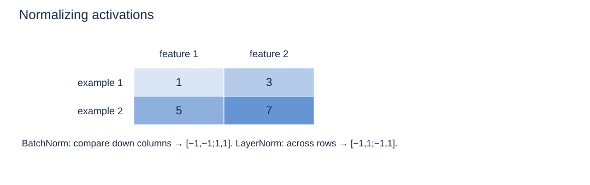
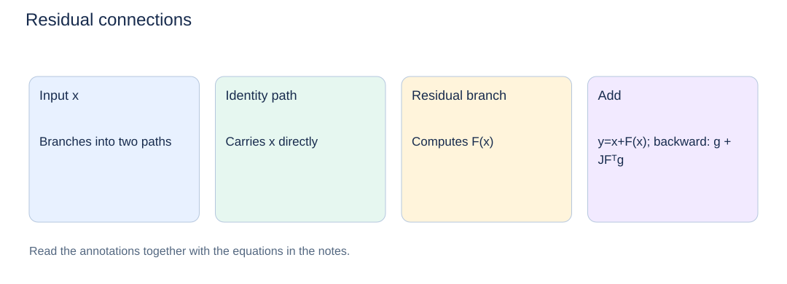
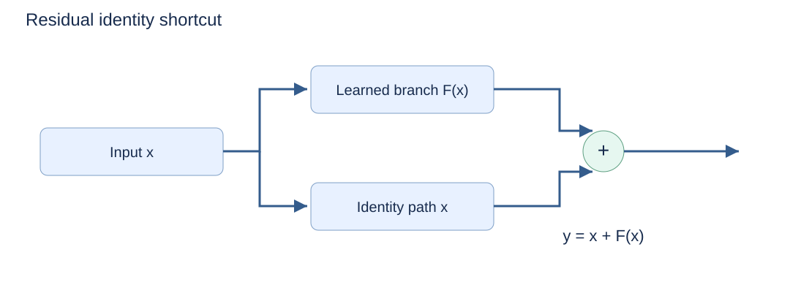

# 1.7 BatchNorm, LayerNorm, and Residual Connections — Study Notes

**Provided Markdown:** [1.7_Normalization_and_Residual_Connections.md](1.7_Normalization_and_Residual_Connections.md). **Slides reviewed:** [COMP664_7_BatchLayerNorm.pdf](COMP664_7_BatchLayerNorm.pdf).

Starred entries preserve points and formulas from the provided Markdown; all teaching additions, examples, and source qualifications are unstarred. The provided Markdown is the available notes/transcript source; no separate verbatim transcript was found. Slide numbers refer to PDF page numbers, including title slides.

**Notation and prerequisites.** $\mu$ denotes a mean, $\sigma^2$ a variance, and $\epsilon>0$ a numerical stabilizer. The trainable $\gamma$ and $\beta$ scale and shift normalized activations. A Jacobian $J_F$ describes how the vector output of $F$ changes with its input.

## Normalizing activations

**Sources:** Batch & Layer Normalization, slides 7–36; provided Markdown section “Normalizing activations.”

★ Both batch normalization and layer normalization standardize activations using

★ Supplied formula:

$$
\hat x=\frac{x-\mu}{\sqrt{\sigma^2+\epsilon}}
$$

★ Supplied formula:

$$
y=\gamma\hat x+\beta.
$$

★ The trainable scale $\gamma$ and shift $\beta$ let the network adjust the normalized representation.

★ The axes used to compute $\mu$ and $\sigma^2$ determine which activations are normalized together.

For dense BatchNorm with $N$ rows and $D$ features, $\mu_j=N^{-1}\sum_ix_{ij}$ and $\sigma_j^2=N^{-1}\sum_i(x_{ij}-\mu_j)^2$. Each feature has its own trainable scale and shift. For LayerNorm over $D$ features, $\mu_i=D^{-1}\sum_jx_{ij}$ and $\sigma_i^2=D^{-1}\sum_j(x_{ij}-\mu_i)^2$; each row is processed independently, typically with shared learned scale and shift vectors over its features.

| Method | Statistics during training | Statistics during inference |
| --- | --- | --- |
| ★ BatchNorm | For dense layers, across examples for each feature. For typical convolutional BatchNorm, across batch and spatial axes for each channel. | Uses running estimates collected during training. |
| ★ LayerNorm | Across the selected feature dimensions of each example or token. | Computes statistics from the same feature dimensions of the current example or token. |

★ For a dense activation matrix $X\in\mathbb R^{N\times D}$ with one example per row, BatchNorm computes statistics down each column and LayerNorm across each row.

★ BatchNorm's training statistics depend on the examples in the minibatch.

★ LayerNorm can normalize one example or token independently of the others.

For $X=\begin{bmatrix}1&3\\5&7\end{bmatrix}$, column means are $(3,5)$ and column variances are $(4,4)$. Ignoring epsilon just for this example, BatchNorm gives $\begin{bmatrix}-1&-1\\1&1\end{bmatrix}$. Row means $(2,6)$ and row variances $(1,1)$ give LayerNorm output $\begin{bmatrix}-1&1\\-1&1\end{bmatrix}$. Epsilon is positive to keep the denominator nonzero; it means normalized variance need not be exactly one.

During ordinary BatchNorm inference, use running training statistics and the learned scale/shift. LayerNorm uses current-token or current-example statistics in both modes. For images, BatchNorm usually reduces over $(N,H,W)$ separately per channel; LayerNorm's exact axes depend on the layer configuration. The slide 36 statement that inputs “never explode or vanish” is too strong: normalization controls a local activation scale, not all gradients or subsequent learned scales. Tiny batches can make BatchNorm statistics noisy, while LayerNorm avoids dependence on other examples.

*Normalize down columns for BatchNorm and across rows for LayerNorm; the outputs differ.*

## Residual connections

**Sources:** Batch & Layer Normalization, slides 38–52; provided Markdown section “Residual connections.”

★ A residual block computes $y=x+F(x)$, where $F$ is a learned transformation.

★ The identity path carries the input forward directly, and $F$ learns a correction.

★ If $F(x)=0$, the block implements the identity.

★ When dimensions differ, a projection can align the skip path with the residual branch before addition.

Learning a residual means learning $F(x)=\mathrm{desired}(x)-x$. An added block can preserve an earlier network's function if its residual branch can be zero and the surrounding operations leave the skip path unchanged. This qualification matters: a post-addition nonlinearity or normalization can change the resulting map, and a dimension-changing projection is not an identity on the original space.

★ The local Jacobian is $I+J_F(x)$.

★ In backpropagation, the identity term gives the incoming gradient a direct path through the addition.

★ This makes it easier to preserve useful features and train a deep stack.

★ In a residual CNN, $F$ can contain convolution, normalization, and nonlinear activations.

★ The skip path adds its output to the input with compatible shapes.

Using column gradients, $\nabla_xL=(I+J_F(x))^\top\nabla_yL=\nabla_yL+J_F(x)^\top\nabla_yL$. The identity term supplies a direct contribution, but it can still be canceled by the residual derivative; residual connections help optimization without guaranteeing nonvanishing gradients. In the scalar case $F(x)=2x$, the gradient multiplier is $3$; if $F(x)=0$, it is $1$. For a projected skip $y=Px+F(x)$, replace $I$ by $P$.

*The residual adds a learned change while preserving a direct contribution from the input.*

*The input travels along both the learned branch and the direct skip path; the outputs add.*

