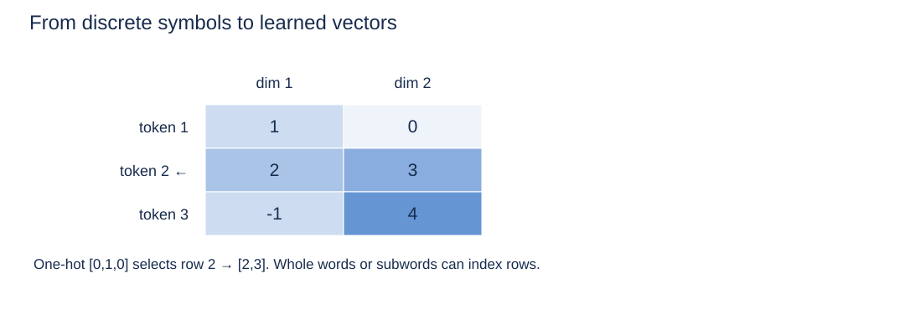
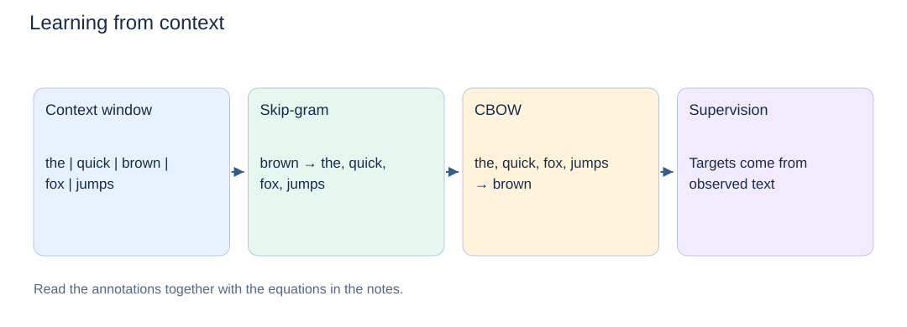
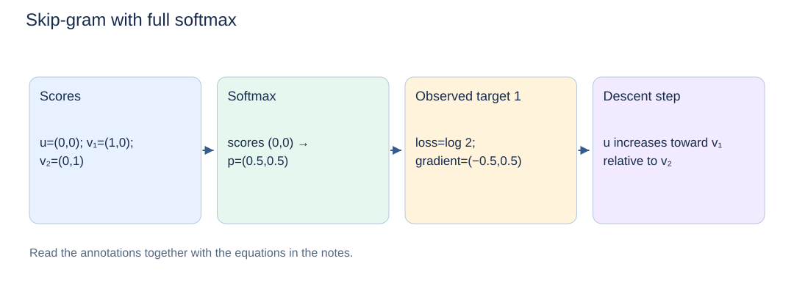
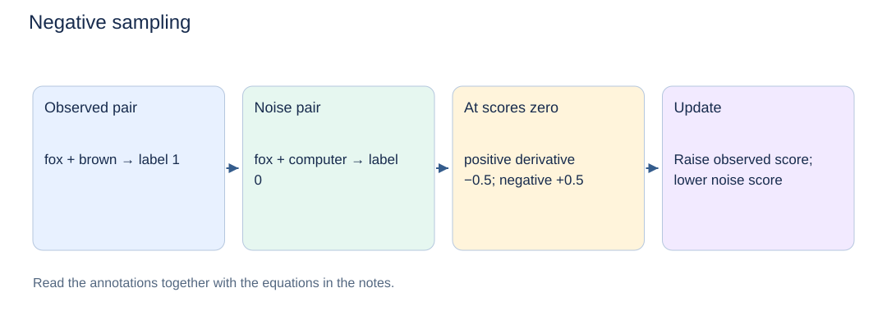
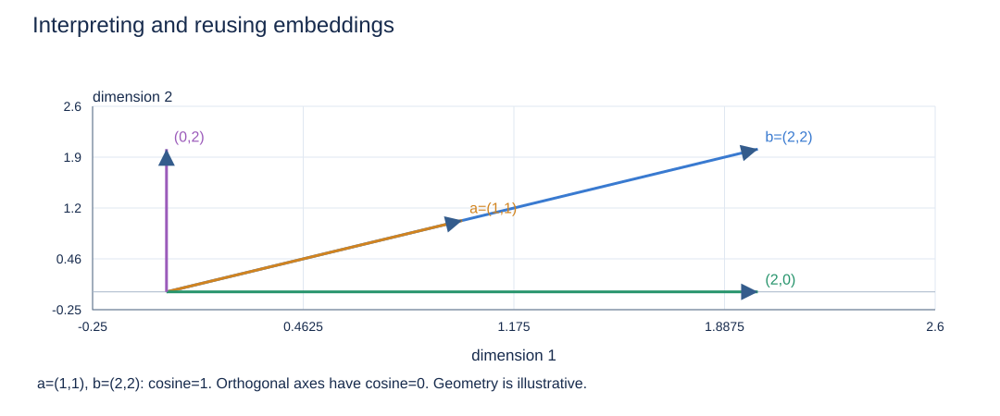
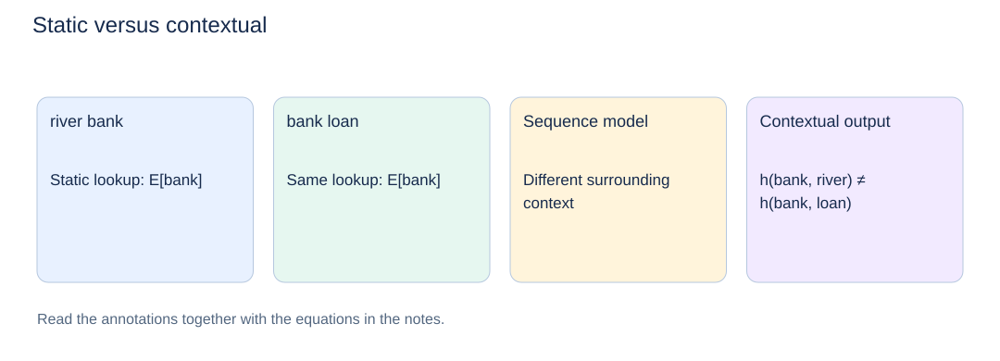

# 1.8 Representation Learning & Embeddings — Study Notes

**Provided Markdown:** [1.8_Representation_Learning_and_Embeddings.md](1.8_Representation_Learning_and_Embeddings.md). **Slides reviewed:** [COMP664_8_WordRepresentations.pdf](COMP664_8_WordRepresentations.pdf).

Starred entries preserve points and formulas from the provided Markdown; all teaching additions, examples, and source qualifications are unstarred. The provided Markdown is the available notes/transcript source; no separate verbatim transcript was found. Slide numbers refer to PDF page numbers, including title slides.

**Notation and prerequisites.** $V$ is the vocabulary, $|V|$ its number of items, and $d$ the embedding width. A token is a discrete symbol; its ID indexes a table rather than representing a numerical magnitude. $\sigma(s)=1/(1+e^{-s})$ is the sigmoid.

## From discrete symbols to learned vectors

**Sources:** Word Embeddings & Representation Learning, slides 4 and 8–9, 29–34; provided Markdown section “From discrete symbols to learned vectors.”

★ An embedding maps a discrete item, such as a token, to a dense vector.

★ An embedding table $E\in\mathbb R^{|V|\times d}$ has one row per vocabulary item.

★ Looking up the row for a token is equivalent to multiplying its one-hot row vector by $E$.

★ This mapping lets models learn relationships between tokens from data.

A one-hot vector has length $|V|$, the vocabulary size, and a single one at the token's index. For token 2 and $E=\begin{bmatrix}1&0\\2&3\\-1&4\end{bmatrix}$, $[0,1,0]E=[2,3]$. In code, a lookup avoids explicitly materializing the one-hot vector. Backpropagation adds all lookup-gradient contributions to each selected row; repeated token occurrences share that row.

★ Tokenization determines the units represented by the table.

★ A token can be a whole word or a subword.

★ Keeping frequent words intact while splitting rare words into reusable pieces can limit vocabulary size and represent words that were rare or unseen as whole units.

An embedding width $d$ is chosen independently of vocabulary size, giving $|V|d$ parameters. Similarity emerges from the training objective, not from the arbitrary numeric token IDs. Subword segmentation trades sequence length against vocabulary size; the precise segmentation is tokenizer-dependent, so an illustrative split is not a universal linguistic decomposition. Subwords improve coverage but do not by themselves make representations contextual.

*Multiplying by a one-hot vector selects exactly one embedding-table row.*

## Learning from context

**Sources:** Word Embeddings & Representation Learning, slides 11–17, 22–25; provided Markdown section “Learning from context.”

★ Distributional learning uses the contexts in which words appear as supervision.

★ A small context window tends to emphasize nearby syntactic or functional relationships, while a larger window can emphasize topical associations.

★ A window of radius two around a center position gives up to four context targets.

★ For “the quick brown fox jumps,” the center word “brown” pairs with “the,” “quick,” “fox,” and “jumps.”

**Self-supervision** constructs targets from the data itself. For window radius $m$, a center at position $t$ yields pairs $(w_t,w_{t+j})$ for $-m\le j\le m$, $j\ne0$, restricted to valid positions. A radius-two window spans five tokens including the center; it produces four context targets only away from sequence boundaries.

★ **Skip-gram** predicts context words from a center word. **Continuous bag-of-words (CBOW)** uses the surrounding context words to predict the center word.

★ The text itself supplies targets for either objective.

Skip-gram creates several center-to-context predictions. CBOW first combines the context vectors (by sum or mean, depending on the convention) and predicts the center once. If $\bar v$ is the combined context representation, one possible CBOW head is $P(c\mid\text{context})=\exp(u_c^\top\bar v)/\sum_w\exp(u_w^\top\bar v)$. Ordinary bag-of-words context aggregation ignores the order within the window. Window-size effects on syntactic versus topical similarity are tendencies observed in training, not strict categories.

*Skip-gram and CBOW reverse which part of the same context window supplies the target.*

## Skip-gram with full softmax

**Sources:** Word Embeddings & Representation Learning, slides 16–17; provided Markdown section “Skip-gram with full softmax.”

★ Use a center embedding $u_c$ and a context embedding $v_o$.

★ Their dot product measures compatibility.

★ For a center token $c$ and a context token $o$,

★ Supplied formula:

$$
P(o\mid c)=\frac{\exp(v_o^\top u_c)}{\sum_{w\in V}\exp(v_w^\top u_c)}.
$$

★ The training loss sums $-\log P(o\mid c)$ over observed center–context pairs.

★ For one pair,

★ Supplied formula:

$$
\nabla_{u_c}[-\log P(o\mid c)]
=\sum_{w\in V} P(w\mid c)v_w-v_o.
$$

There are two learned tables: center vectors $u$ and context vectors $v$. Their roles should remain fixed even though some lecture formulas interchange letters. For one observed pair $(c,o)$, write $\ell=-v_o^\top u_c+\log\sum_w\exp(v_w^\top u_c)$. Differentiating the log-sum-exp yields the expected context vector under the model, giving your gradient. Gradient descent moves $u_c$ toward the observed $v_o$ relative to that expectation.

★ The update moves the center vector toward the observed context vector relative to the context vectors the model currently expects.

★ Full softmax requires summing over the vocabulary.

For a two-word context vocabulary, suppose $v_1=(1,0)^\top$, $v_2=(0,1)^\top$, $u_c=(0,0)^\top$, and $o=1$. Both probabilities are $1/2$, so the loss is $\log2$ and $\nabla_{u_c}\ell=(-1/2,1/2)^\top$. The negative gradient increases the observed word's score and decreases the alternative's. Computing the exact denominator and its gradients requires all vocabulary vectors. Slide 17's summation denominator appears to repeat a fixed target index; it must range over $v_w$, as your notes correctly do.

*At equal initial scores, the gradient moves toward the observed context relative to the alternative.*

## Negative sampling

**Sources:** Word Embeddings & Representation Learning, slides 18–20; provided Markdown section “Negative sampling.”

★ A binary objective can distinguish observed center–context pairs from sampled noise pairs.

★ An observed pair such as “brown” and “fox” is a positive training example.

★ Randomly sampled context words paired with the same center are treated as negatives.

★ The score $v_w^\top u_c$ goes through a sigmoid.

★ With one observed context $o$ and sampled negatives $n_1,\ldots,n_K$, the loss is

★ Supplied formula:

$$
-\log\sigma(v_o^\top u_c)-\sum_{k=1}^{K}\log\sigma(-v_{n_k}^\top u_c).
$$

Let $s_o=v_o^\top u_c$ and $s_{n_k}=v_{n_k}^\top u_c$. The positive term has score derivative $\sigma(s_o)-1$; a negative term has derivative $\sigma(s_{n_k})$. Therefore $\nabla_{u_c}\ell=(\sigma(s_o)-1)v_o+\sum_k\sigma(s_{n_k})v_{n_k}$. The loss trains binary compatibility with observed versus sampled pairs; it is a different objective from computing exact full-softmax likelihood.

★ The update uses the observed context and the sampled negatives, avoiding a full-vocabulary softmax.

At zero scores with one negative, the loss is $2\log2$, the positive score derivative is $-1/2$, and the negative score derivative is $1/2$. A sampled “negative” is a noise example, not proof that two words can never co-occur. **Slide discrepancy:** slide 20's positive-pair sigmoid appears to omit the minus sign in $e^{-s}$, and its maximization expression subtracts a negative-pair log probability. A consistent maximization is $\log\sigma(s_o)+\sum_k\log\sigma(-s_{n_k})$; your notes correctly negate this entire expression for minimization.

*The observed pair and sampled noise pair push their compatibility scores in opposite directions.*

## Interpreting and reusing embeddings

**Sources:** Word Embeddings & Representation Learning, slides 6, 25–29 and 33–34; provided Markdown section “Interpreting and reusing embeddings.”

★ Words that occur in similar contexts can occupy nearby parts of the embedding space.

★ Similarity can be compared with cosine similarity or inspected with a two-dimensional projection such as UMAP.

★ A projection gives a partial view of the high-dimensional geometry.

★ Some word relations also appear as vector offsets, as in the illustrative analogy $\mathrm{king}-\mathrm{man}+\mathrm{woman}\approx\mathrm{queen}$.

For nonzero vectors, cosine similarity is $\cos(a,b)=a^\top b/(\|a\|_2\|b\|_2)$. Vectors $(1,1)$ and $(2,2)$ have cosine one despite differing lengths; $(1,0)$ and $(0,1)$ have cosine zero. It is undefined if either vector is zero. Distance and similarity measure different quantities: larger cosine means greater directional alignment. A 2D projection may distort distances and should not be read as the complete embedding geometry.

★ Learned embedding tables can initialize another model.

★ The downstream model can keep the vectors fixed or fine-tune them.

★ A static embedding gives each token one vector across contexts, so a word with several senses has a single lookup representation.

An analogy tests whether relation vectors approximately align; it is an empirical property, not an algebraic law about meaning. Freezing embeddings saves updates and preserves a pretrained representation; fine-tuning adapts it to the downstream objective. Static “bank” has one lookup vector in both river and finance contexts, while an RNN or Transformer can turn that same initial vector into distinct contextual states. Both semantic regularities and corpus biases can appear in learned neighborhoods.

*Parallel vectors have cosine similarity one regardless of their lengths; orthogonal vectors have zero.*

*The lookup is shared, but the contextual representation can differ by sentence.*

