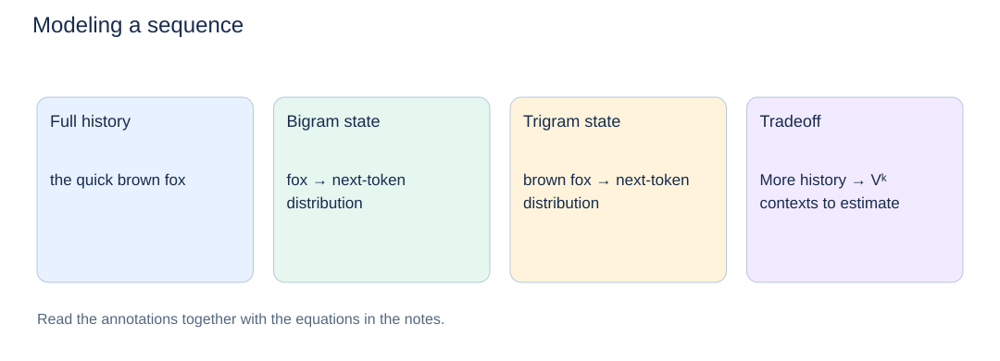
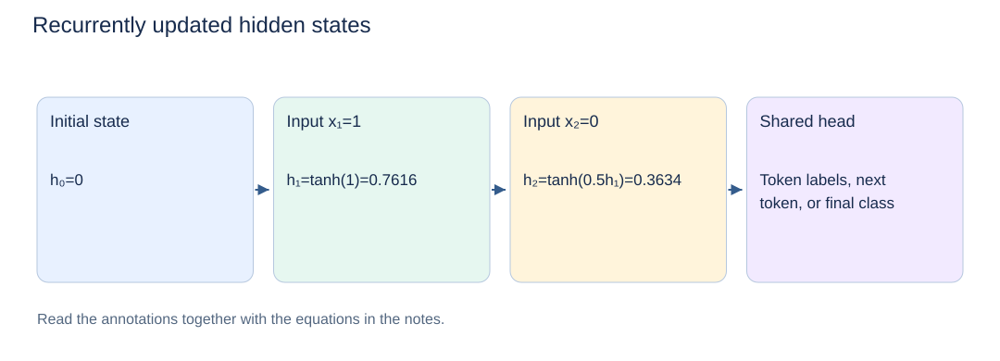
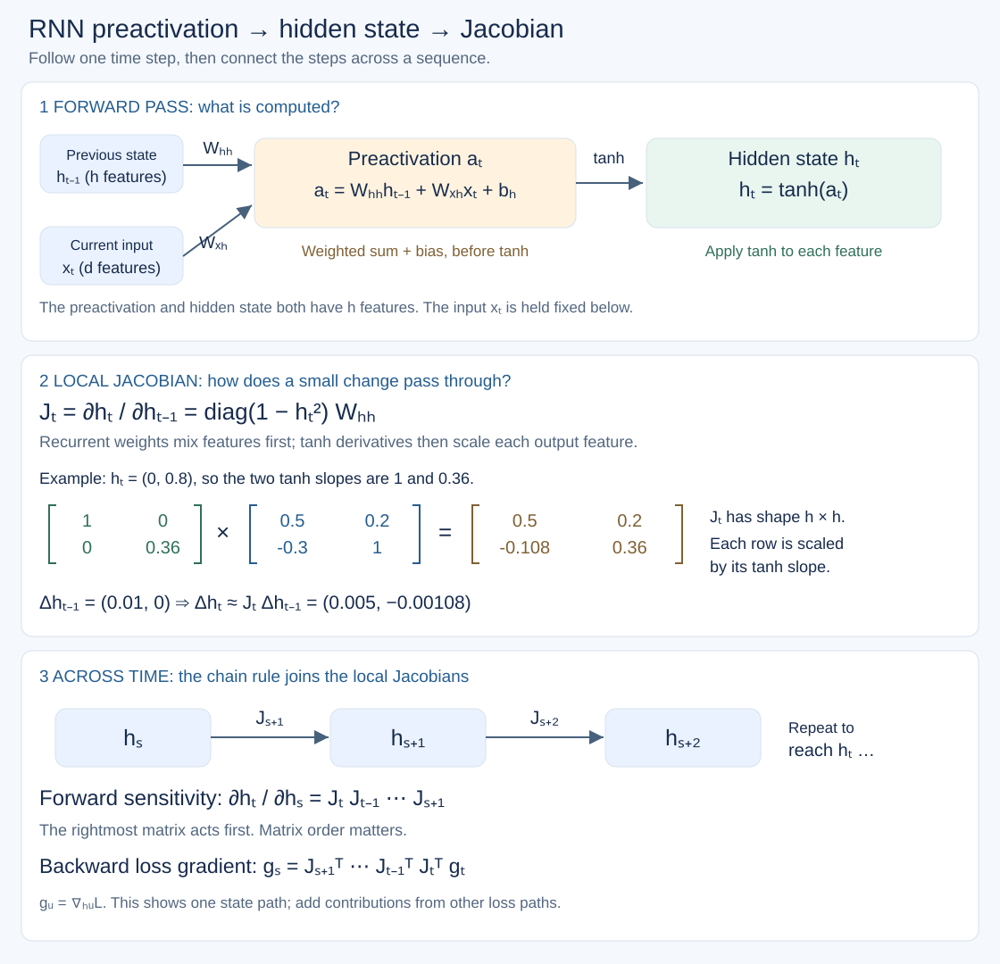
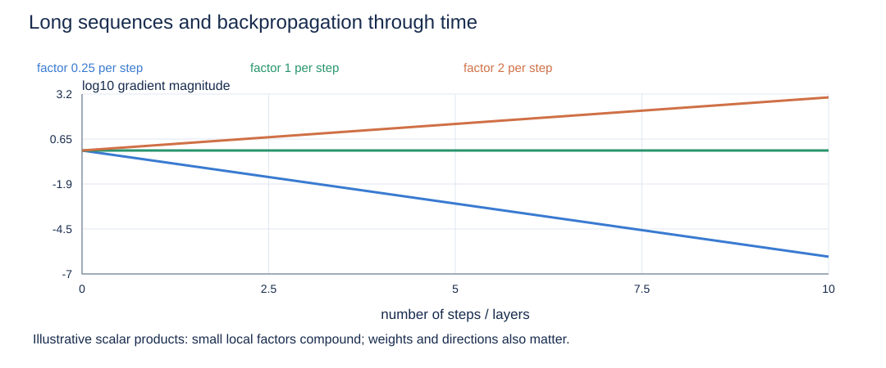

# 2.1 Sequence Modeling and RNNs — Study Notes

**Provided Markdown:** [2.1_Sequence_Modeling_and_RNNs.md](2.1_Sequence_Modeling_and_RNNs.md). **Slides reviewed:** [COMP664_9_SequentialModels.pdf](COMP664_9_SequentialModels.pdf).

Starred entries preserve points and formulas from the provided Markdown; all teaching additions, examples, and source qualifications are unstarred. The provided Markdown is the available notes/transcript source; no separate verbatim transcript was found. Slide numbers refer to PDF page numbers, including title slides.

**Notation and prerequisites.** $t$ indexes positions, $T$ is sequence length, $x_t$ is the current input vector, and $h_t$ is a hidden-state vector. $x_{<t}$ means all inputs preceding $t$. $\tanh$ is an elementwise nonlinearity mapping real values into $(-1,1)$.

## Modeling a sequence

**Sources:** Modeling Sequential Data, slides 4–19; provided Markdown section “Modeling a sequence.”

★ Words in a sentence, frames in a video, and observations over time are examples of sequential data.

★ A sequence model uses the observations available so far to represent the current state and make predictions.

★ A Markov model of order $k$ predicts the next state using the $k$ most recent states.

★ A first-order word model conditions the next word on one previous word, giving a bigram model.

★ A second-order model conditions it on the two most recent words, giving a trigram model.

★ Increasing the order lets the model use more history, but the number of possible contexts grows and individual contexts become harder to estimate from data.

The probability chain rule is exact: $P(x_1,\ldots,x_T)=\prod_{t=1}^TP(x_t\mid x_{<t})$. The order-$k$ Markov assumption approximates each factor by $P(x_t\mid x_{t-k},\ldots,x_{t-1})$, with start conventions for early positions. A bigram uses one previous token plus the predicted token; a trigram uses two plus the predicted token. These names count all tokens in the local event.

With vocabulary size $V$, a fully tabulated order-$k$ transition model has $V^k$ possible length-$k$ contexts and $V-1$ free probabilities for each, or $V^k(V-1)$ transition degrees of freedom, excluding start distributions. Increasing $k$ rapidly creates rarely observed contexts. Slide 19's “lack of memory” means no memory **beyond the retained context**, not literally none. Stationarity is a further assumption of a time-homogeneous Markov model, not a consequence of the Markov property itself.

*Increasing Markov order retains more recent tokens but increases the possible context table.*

## Recurrently updated hidden states

**Sources:** Modeling Sequential Data, slides 21–25 and 31–32; provided Markdown section “Recurrently updated hidden states.”

★ A recurrent neural network (RNN) reads the sequence one element at a time.

★ The same learned function updates a continuous hidden-state vector at each step:

★ Supplied formula:

$$
h_t=f_\theta(h_{t-1},x_t).
$$

★ For a simple RNN, the update can be written as $h_t=\tanh(W_{hh}h_{t-1}+W_{xh}x_t+b_h)$.

★ The vector $h_t$ is a learned representation of the prefix $x_1,\ldots,x_t$.

★ The update function is shared across time, so the RNN can process sequences of different lengths.

Let input width be $d$ and hidden width be $h$. Then $W_{xh}\in\mathbb R^{h\times d}$, $W_{hh}\in\mathbb R^{h\times h}$, and $b_h\in\mathbb R^h$. The recurrence has $hd+h^2+h$ parameters regardless of sequence length; an output head adds its own parameters. These correspond to the lecture's $W_2$, $W_1$, and bias. Initialize $h_0$ to a fixed or learned vector.

### Why the recurrence has $hd+h^2+h$ parameters

Here $d$ is the number of input features at each time step, and $h$ is the number of hidden-state features. Count the learned entries in the update

$$
h_t=\tanh(W_{xh}x_t+W_{hh}h_{t-1}+b_h).
$$

| Learned object             | Shape       | Number of parameters | Purpose                                                                  |
| -------------------------- | ----------- | -------------------- | ------------------------------------------------------------------------ |
| Input weights $W_{xh}$     | $h\times d$ | $hd$                 | Map the current input's $d$ features to $h$ hidden features.             |
| Recurrent weights $W_{hh}$ | $h\times h$ | $h^2$                | Map the previous hidden state's $h$ features to the new hidden features. |
| Bias $b_h$                 | $h$         | $h$                  | Add one learned offset per hidden unit.                                  |
| **Total**                  |             | **$hd+h^2+h$**       |                                                                          |

Step by step, each of the $h$ hidden units has $d$ input weights, $h$ recurrent weights, and one bias. That is $d+h+1$ parameters per hidden unit, or $h(d+h+1)=hd+h^2+h$ across all hidden units. The tanh function has no learned parameters.

**Example.** With input width $d=3$ and hidden width $h=5$:

1. Input weights: $5\times3=15$.
2. Recurrent weights: $5\times5=25$.
3. Biases: $5$.
4. Total: $15+25+5=45$ learned parameters.

**Why sequence length does not appear.** At time steps 1, 2, and 3, the model applies

$$
\begin{aligned}
h_1&=\tanh(W_{xh}x_1+W_{hh}h_0+b_h),\\
h_2&=\tanh(W_{xh}x_2+W_{hh}h_1+b_h),\\
h_3&=\tanh(W_{xh}x_3+W_{hh}h_2+b_h).
\end{aligned}
$$

These equations all use the **same** $W_{xh}$, $W_{hh}$, and $b_h$. Unrolling the RNN shows repeated uses of the same parameters, rather than a new set for each time step. The example therefore has 45 recurrence parameters for a sequence of length 3, 30, or 300. During backpropagation, all time steps contribute gradients to those shared parameters.

Longer sequences still require more computation and, in ordinary full backpropagation through time, more stored intermediate activations. Hidden states $h_1,\ldots,h_T$ are computed activations; they are not separate learned parameter vectors.

**What this count includes.** The formula counts one simple RNN layer with one bias vector. A fixed initial state (often zeros) adds no parameters; a learned initial state adds $h$. A separate output layer mapping $h$ hidden features to $C$ logits with a bias adds $Ch+C$. Additional recurrent layers or architectures such as LSTMs have their own parameter counts. Some implementations store separate input and recurrent biases, which changes the bias count to $2h$.

★ A prediction head can use $h_t$ at every time step, for example to label the current word, predict the next word, or forecast the next weather observation.

★ For a sequence-level classification task, a head can use the final state $h_T$ to make one prediction about the entire input.

★ Backpropagation trains the recurrent update and the prediction head jointly.

For a one-dimensional example, $h_t=\tanh(0.5h_{t-1}+x_t)$, $h_0=0$, and inputs $(1,0)$ give $h_1\approx0.7616$ and $h_2\approx0.3634$. The second state still depends on the first input even though the current input is zero. The hidden state can summarize an arbitrarily long prefix in principle, but a fixed-dimensional state need not retain every detail. A sequence-labeling head aligns with the current position; a next-token head predicts the following token; a sequence-classification head can use the final state.

*The second hidden state still carries information from the first input when the current input is zero.*

## Long sequences and backpropagation through time

**Sources:** Advanced Topics with RNNs, slides 12–15; Modeling Sequential Data, slides 24 and 32; provided Markdown section “Long sequences and backpropagation through time.”

★ Backpropagation through time follows the unrolled sequence of recurrent updates.

★ A loss at a late time step sends its gradient back to earlier steps through repeated multiplication by the Jacobians of the update function.

★ Products that contract repeatedly can cause gradients to vanish, while products that expand repeatedly can cause them to explode.

★ As the distance between a prediction and the input that influenced it grows, learning that dependency can become harder.

For preactivation $a_t=W_{hh}h_{t-1}+W_{xh}x_t+b_h$, the local Jacobian of a tanh RNN is $J_t=\operatorname{diag}(1-h_t^2)W_{hh}$. The derivative $\partial h_t/\partial h_s$ for $s<t$ is the ordered product $J_tJ_{t-1}\cdots J_{s+1}$. All occurrences of a shared parameter contribute to the same parameter gradient, just as all spatial filter uses do in a CNN.

*Read top to bottom: compute the preactivation, apply tanh, build the local Jacobian, then multiply Jacobians across time. The numerical panel illustrates a small perturbation with a first-order approximation.*

### Gradient vs. Jacobian

- **Gradient:** derivatives of a scalar loss with respect to a vector:

  $$
  \nabla_{h_t}L=
  \begin{bmatrix}
  \partial L/\partial h_{t,1}\\
  \vdots\\
  \partial L/\partial h_{t,h}
  \end{bmatrix}
  \in\mathbb R^h.
  $$

- **Jacobian:** derivatives of a vector output with respect to a vector input:

  $$
  J_t=\frac{\partial h_t}{\partial h_{t-1}}\in\mathbb R^{h\times h}.
  $$

### Why a Jacobian appears: the linear algebra

An RNN maps a vector to another vector. A scalar derivative measures how one output number changes with one input number; a **Jacobian** collects how every output feature changes with every input feature. Here we ask: if the previous hidden state changes slightly, how does the next hidden state change? Hold the current input and parameters fixed for this derivative.

**1. Matrix multiplication mixes features.** For two hidden features, write

$$
h_{t-1}=\begin{bmatrix}u\\v\end{bmatrix},\qquad
W_{hh}=\begin{bmatrix}0.5&0.2\\-0.3&1\end{bmatrix},\qquad
c=W_{xh}x_t+b_h.
$$

Then the preactivation is

$$
a_t=W_{hh}h_{t-1}+c
=\begin{bmatrix}0.5u+0.2v+c_1\\-0.3u+v+c_2\end{bmatrix}.
$$

Each row gives the weights used to produce one preactivation feature. Because this transformation is affine, its change is exactly $\Delta a_t=W_{hh}\Delta h_{t-1}$. Thus $\partial a_t/\partial h_{t-1}=W_{hh}$. The fixed input and bias affect the preactivation value but have zero derivative with respect to the previous state.

**2. A Jacobian is a table of partial derivatives.** For two hidden features,

$$
J_t=\begin{bmatrix}
\dfrac{\partial h_{t,1}}{\partial u}&\dfrac{\partial h_{t,1}}{\partial v}\\[6pt]
\dfrac{\partial h_{t,2}}{\partial u}&\dfrac{\partial h_{t,2}}{\partial v}
\end{bmatrix}.
$$

Rows correspond to output features and columns to previous-state features. Entry $(i,j)$ measures the sensitivity of new feature $i$ to previous feature $j$. Locally, $\Delta h_t\approx J_t\Delta h_{t-1}$; the approximation accounts for the nonlinear tanh step.

**3. Elementwise tanh gives a diagonal derivative matrix.** Each output feature uses only its corresponding preactivation: $h_{t,i}=\tanh(a_{t,i})$. Therefore

$$
D_t=\frac{\partial h_t}{\partial a_t}
=\begin{bmatrix}1-h_{t,1}^2&0\\0&1-h_{t,2}^2\end{bmatrix}
=\operatorname{diag}(1-h_t^2).
$$

The off-diagonal entries are zero because changing preactivation feature 2 does not directly change output feature 1 at this elementwise stage. The square is elementwise. For $h_t=(0,0.8)^\top$, the diagonal entries are 1 and 0.36: the second feature is closer to saturation and responds less strongly.

**4. The multivariable chain rule becomes a matrix product.** Follow the two transformations $h_{t-1}\to a_t\to h_t$:

$$
J_t=\frac{\partial h_t}{\partial a_t}
\frac{\partial a_t}{\partial h_{t-1}}
=D_tW_{hh}
=\begin{bmatrix}1&0\\0&0.36\end{bmatrix}
\begin{bmatrix}0.5&0.2\\-0.3&1\end{bmatrix}
=\begin{bmatrix}0.5&0.2\\-0.108&0.36\end{bmatrix}.
$$

Left-multiplication by a diagonal matrix scales each row: each output's tanh slope scales all weights feeding into that output. With hidden width $h$, both factors and the resulting Jacobian have shape $h\times h$.

For a small perturbation,

$$
\Delta h_{t-1}=\begin{bmatrix}0.01\\0\end{bmatrix}
\quad\Longrightarrow\quad
\Delta h_t\approx\begin{bmatrix}0.005\\-0.00108\end{bmatrix}.
$$

Changing one previous feature can affect several new features because the recurrent weight matrix mixes them.

**5. Across time, compose the transformations in order.** First apply $J_{s+1}$, then $J_{s+2}$, continuing until $J_t$. This gives

$$
\frac{\partial h_t}{\partial h_s}=J_tJ_{t-1}\cdots J_{s+1}.
$$

The rightmost matrix acts first. Matrix multiplication generally does not commute: mixing and scaling directions in a different order can produce a different result. Repeated products can contract some directions and amplify others, which connects this linear algebra to vanishing and exploding gradients.

**6. Why backpropagation uses the transpose.** With column-vector gradients, one backward step is

$$
\nabla_{h_{t-1}}L=J_t^\top\nabla_{h_t}L.
$$

In coordinates, the gradient for previous feature $j$ is $\sum_i (\partial L/\partial h_{t,i})(\partial h_{t,i}/\partial h_{t-1,j})$. The transpose performs precisely this sum over output features, sending their loss contributions back to the previous features that influenced them. This is the contribution through the next state; add any direct loss or other branch contributions as well.

**What the local Jacobian means.** The hidden state is $h_t=\tanh(a_t)$, with tanh applied separately to each feature. Its derivative for feature $i$ is $1-h_{t,i}^2$. The notation $\operatorname{diag}(1-h_t^2)$ places those derivatives on the diagonal of a matrix; the square is elementwise. Multiplying by $W_{hh}$ applies the chain rule through the preactivation. Thus $J_t$ is an $h\times h$ matrix whose entry $(i,j)$ measures how a small change in feature $j$ of $h_{t-1}$ changes feature $i$ of $h_t$, with the current input held fixed:

$$
\Delta h_t\approx J_t\Delta h_{t-1}.
$$

**Why the matrices multiply in this order.** A change to $h_s$ first passes through the update at $s+1$, then $s+2$, and so on. For two steps,

$$
\Delta h_{s+2}\approx J_{s+2}\Delta h_{s+1}
\approx J_{s+2}J_{s+1}\Delta h_s.
$$

The rightmost matrix acts first. Continuing gives $J_tJ_{t-1}\cdots J_{s+1}$; order matters because matrix multiplication generally does not commute. For a loss $L$ that depends on $h_t$, the gradient contribution through this state path travels backward with transposes:

$$
\nabla_{h_s}L
=(J_tJ_{t-1}\cdots J_{s+1})^\top\nabla_{h_t}L.
$$

If there are losses or other branches at intermediate steps, their gradient contributions must also be added.

**Real-world example: remembering the subject of a sentence.** Suppose a next-word RNN reads “The **keys** to the cabinet near the door **are** missing.” To predict “are” rather than “is,” it needs information about the plural subject “keys,” despite intervening words such as the singular noun “cabinet.” Let $s$ be the position of “keys” and $t$ the position of “door,” whose hidden state is used to predict the next word. There are six recurrent updates between these states. The Jacobian product describes how a small change in the state at “keys” affects the state used for that prediction.

As a simplified illustration, suppose the relevant signal follows a scalar path with local derivative $0.5$ at each of those six updates. Its sensitivity becomes $0.5^6=1/64\approx0.0156$. The error signal sent backward along that path is similarly weakened, making it harder to learn that the early plural subject should guide the later verb. With a local derivative of $1.5$ instead, the factor would be $1.5^6\approx11.39$, amplifying the signal. Actual RNNs use matrices that mix directions, so these scalar factors illustrate contraction and expansion rather than specify a trained model's behavior. A weak gradient means difficult credit assignment; it does not by itself prove the model has forgotten the subject.

★ The forward computation is also sequential.

★ Computing $h_{100}$ requires $h_{99}$, which requires $h_{98}$, and so on.

★ This dependency limits how much computation can be parallelized across positions in a sequence.

Repeatedly contracting directions lose gradient signal; expanding directions can make updates unstable. The recurrent weights alone do not determine the outcome because nonlinear derivatives and directions also matter. Gradient clipping limits exploding norms. Truncated backpropagation cuts the gradient history to a finite segment, reducing memory and compute but preventing direct credit assignment across that cut. These are backward-pass issues; the forward dependency $h_t\leftarrow h_{t-1}$ separately prevents simultaneous computation of all states in a simple RNN.

*Products of local Jacobians can contract or expand gradient magnitudes exponentially with distance.*
