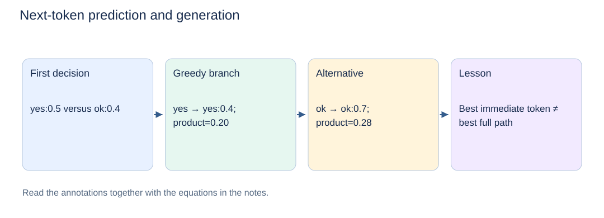
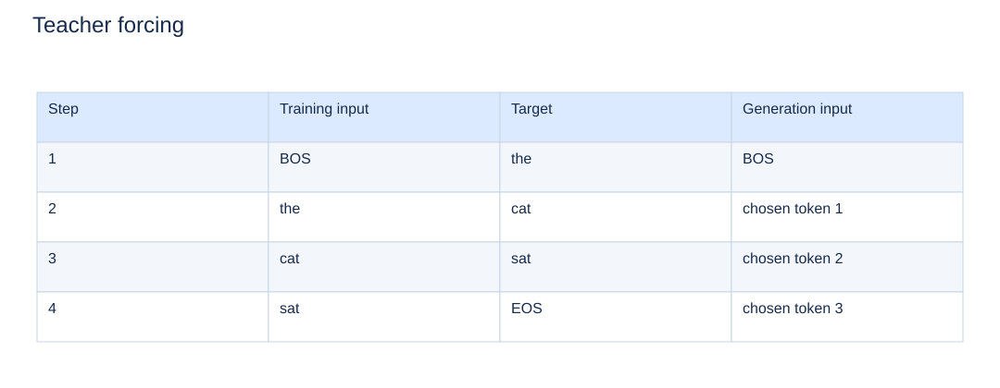
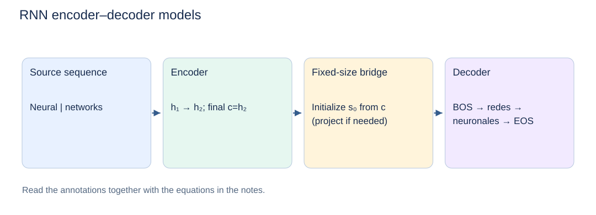
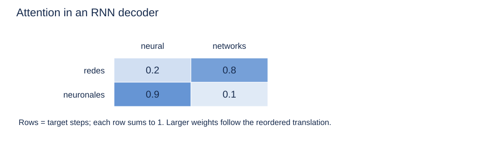
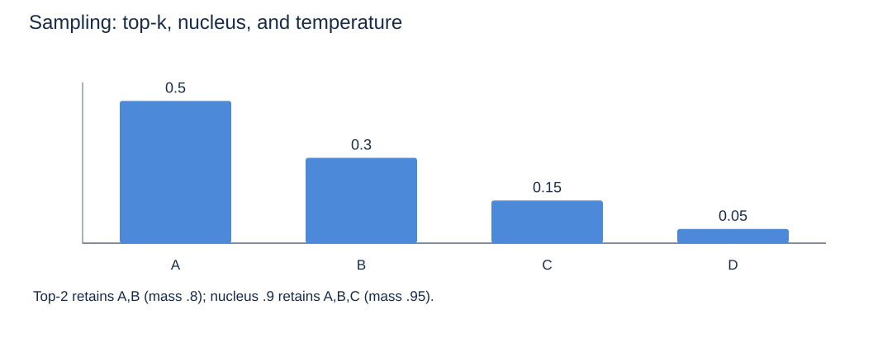
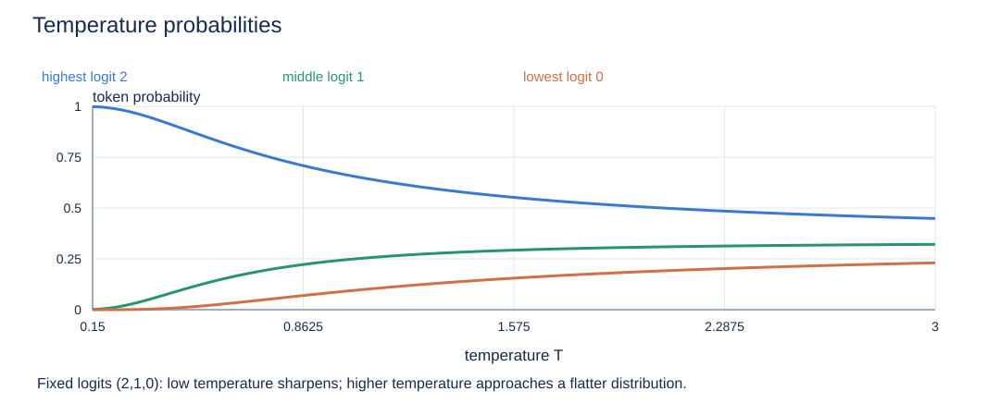

# 2.2 Sequence Generation, Teacher Forcing, Sampling, and Seq2Seq Models — Study Notes

**Provided Markdown:** [2.2_Sequence_Generation_and_Seq2Seq.md](2.2_Sequence_Generation_and_Seq2Seq.md). **Slides reviewed:** [COMP664_W10_AdvancedRNNs.pdf](COMP664_W10_AdvancedRNNs.pdf).

Starred entries preserve points and formulas from the provided Markdown; all teaching additions, examples, and source qualifications are unstarred. The provided Markdown is the available notes/transcript source; no separate verbatim transcript was found. Slide numbers refer to PDF page numbers, including title slides.

**Notation and prerequisites.** $w_t$ or $y_t$ denotes a token at position $t$, $T$ is target length, and $p(a\mid b)$ means a probability conditional on $b$. BOS and EOS denote beginning and end of sequence. A logit is an unnormalized score; softmax turns a score vector into probabilities.

## Next-token prediction and generation

**Sources:** Advanced Topics with RNNs, slides 5–8 and 17–22; provided Markdown section “Next-token prediction and generation.”

★ An autoregressive language model maps a prefix $w_1,\ldots,w_{t-1}$ to a probability distribution over the next token.

★ A prediction head produces vocabulary logits from the current representation, and softmax converts the logits to probabilities.

★ Repeating the next-token prediction defines a probability for the whole sequence:

★ Supplied formula:

$$
p(w_1,\ldots,w_T)=\prod_{t=1}^{T}p(w_t\mid w_1,\ldots,w_{t-1}).
$$

★ To generate text, choose a token from the current distribution, append it to the prefix, and compute the next distribution using the updated prefix.

★ A start token can provide the initial input, and an end token can signal completion.

Each factor conditions on the actual preceding sequence; the first factor uses an empty prefix or a start token. To define a distribution over variable-length outputs, include an end-of-sequence convention. The training loss for a known target is $-\sum_t\log p(w_t\mid w_{<t})$; the model need not sample a token to compute this loss. Generation instead must choose the next token before continuing.

★ **Sampling** draws the next token according to the predicted distribution.

★ Repeating generation from the same prefix can produce different continuations.

★ **Greedy decoding** chooses the highest-probability token at each step.

★ The probability of a complete sequence is the product of the conditional probabilities along its path, so a locally optimal choice can lead to a lower-probability complete sequence.

**Why greedy can fail.** Slide 18's example assigns the first token “yes” probability $0.5$ and “ok” probability $0.4$. The best indicated continuation after “yes” has conditional probability $0.4$, while after “ok” it has probability $0.7$. With end-token probability one, greedy yields $0.5\cdot0.4=0.20$, while “ok, ok” yields $0.4\cdot0.7=0.28$. Beam search retains multiple **cumulative** prefix scores, usually sums of log probabilities. Finite beam width still does not guarantee the globally best sequence; raw probabilities can also favor shorter sequences.

*Compare the products along two branches: the best immediate token can lead to the worse full sequence.*

## Teacher forcing

**Sources:** Advanced Topics with RNNs, slides 5–9; provided Markdown section “Teacher forcing.”

★ During training, the decoder receives the ground-truth token from the previous position as input and learns to predict the ground-truth token at the current position.

★ For a target sequence $y_1,y_2,y_3$, the inputs are $\langle\mathrm{BOS}\rangle,y_1,y_2$ and the prediction targets are $y_1,y_2,y_3$.

★ This shifted alignment is the meaning of feeding the correct next token into the following step.

★ During generation, the token the model actually selected becomes the next input.

Align inputs and targets before computing the loss. For “the cat sat,” inputs $[\mathrm{BOS},\mathrm{the},\mathrm{cat},\mathrm{sat}]$ align with targets $[\mathrm{the},\mathrm{cat},\mathrm{sat},\mathrm{EOS}]$. At position $t$, the model sees the correct previous tokens, not the correct current target token. This avoids target leakage while evaluating the exact autoregressive likelihood of the observed sequence.

The train–generation mismatch is often called **exposure bias**: training prefixes are observed text, but generation prefixes can contain the model's own errors. Teacher forcing itself does not require sampling or replacing the correct training input with an argmax. An RNN remains sequential across positions despite known inputs. A causally masked Transformer can evaluate all known training prefixes together because it removes the recurrent-state dependency.

*Training uses the preceding gold token, while generation uses the preceding selected token.*

## RNN encoder–decoder models

**Sources:** Attention & Transformers, slides 5–7; source section “RNN encoder–decoder models”; provided Markdown section “RNN encoder–decoder models.”

★ Sequence-to-sequence models take an input sequence and generate an output sequence, potentially of a different length.

★ Machine translation is an example.

★ An encoder RNN reads a source sentence and produces hidden states $h_1,\ldots,h_L$.

★ A decoder RNN generates the target sentence one token at a time, conditioned on the encoded input and the target prefix.

The supplied advanced-RNN slide deck covers generation, teacher forcing, and sampling, but the seq2seq content in this source file aligns with **the next deck**, Attention & Transformers, slides 5–10. This cross-lecture source mismatch is explicit so the explanation remains traceable.

Write encoder states as $h_i=f_{\mathrm{enc}}(h_{i-1},x_i)$ and decoder states as $s_t=f_{\mathrm{dec}}(s_{t-1},e(y_{t-1}),c)$. The fixed context $c=h_L$ can initialize the decoder or enter each update. If encoder and decoder widths differ, a learned projection can map the final encoder state to the initial decoder state. A softmax head then models $p(y_t\mid y_{<t},x_{1:L})$.

★ In the basic encoder–decoder model, the encoder passes its final hidden state to the decoder.

★ This creates a fixed-size bottleneck because the final state has to carry all source information relevant to the output.

★ The problem becomes more pronounced for long inputs.

The encoder reads the source before the decoder generates its target, so the output can have a different length and order. A single context vector is a representational bottleneck: the decoder cannot directly retrieve an earlier source state once it has been compressed away. Attention replaces exclusive reliance on that one vector with access to all encoder states.

*The source is compressed into a fixed-size bridge before the target sequence is decoded.*

## Attention in an RNN decoder

**Sources:** Attention & Transformers, slides 8–10; source section “Attention in an RNN decoder”; provided Markdown section “Attention in an RNN decoder.”

★ Attention gives the decoder access to the encoder's hidden state at each source position.

★ At a target step $t$, the decoder uses its current state to score how relevant each source state $h_i$ is.

★ Softmax turns these scores into attention weights $\alpha_{ti}$ that sum to one across source positions.

★ The decoder uses the weighted sum of the source states as a context vector:

★ Supplied formula:

$$
c_t=\sum_{i=1}^{L}\alpha_{ti}h_i.
$$

To avoid a circular definition, a common implementation scores source states using the **previous** decoder state: $e_{ti}=\operatorname{score}(s_{t-1},h_i)$, $\alpha_{ti}=\exp(e_{ti})/\sum_j\exp(e_{tj})$, $c_t=\sum_i\alpha_{ti}h_i$, then $s_t=f_{\mathrm{dec}}(s_{t-1},e(y_{t-1}),c_t)$. A dot-product score requires compatible widths; an additive scoring network can handle projected states. Some variants score with an intermediate current state, so the precise order must be specified.

★ The decoder can compute a different context vector at each step.

★ For example, translating “neural networks” into Spanish can produce “redes neuronales,” reversing the order of the corresponding words.

★ When generating “redes,” the decoder can put more weight on “networks,” then shift its attention toward “neural” when generating “neuronales.” This is a soft alignment because the decoder can distribute weight across several source words.

★ A translation attention map shows this pattern.

★ Each row corresponds to a target step, each column to a source position, and each row sums to one.

★ These alignments can emerge from training on sentence pairs without explicit word-by-word alignment labels.

**Notation check.** Your matrix uses $\alpha_{ti}$ with target steps as rows. Slide 9 writes $\alpha_{it}$ with source index first. Both are valid after transposition, provided the softmax sums across source positions. If the two source states are $h_1=(1,0)$ for “neural” and $h_2=(0,1)$ for “networks,” weights $(0.2,0.8)$ yield $c_t=(0.2,0.8)$ when generating “redes.” A different row $(0.9,0.1)$ emphasizes “neural” for “neuronales.” These are illustrative, not measured alignments. End-to-end translation loss can learn the weights without gold alignment labels.

*Each target row sums to one and emphasizes the source word relevant to that translation step.*

## Sampling: top-k, nucleus, and temperature

**Additional material from slides:** Advanced Topics with RNNs, slides 24–33.

These methods fill a gap between the source notes' basic sampling discussion and the slide deck. For logits $z_j$ and temperature $T>0$, define $p_T(j)=\exp(z_j/T)/\sum_k\exp(z_k/T)$. Temperature changes score differences: $T<1$ sharpens the distribution and $T>1$ flattens it. As $T\to0^+$, probability concentrates on maximizing logits (sharing mass in a tie); temperature zero is a limiting convention, not a valid divisor.

**Top-k sampling** retains the $k$ largest probabilities and renormalizes over that set. **Nucleus sampling** sorts probabilities in decreasing order and retains the smallest prefix whose cumulative mass is at least a threshold $p\in(0,1]$, then renormalizes. Here $p$ is a probability-mass threshold, not a percentage of vocabulary items. With distribution $(0.5,0.3,0.15,0.05)$, top-$k$ with $k=2$ gives $(0.625,0.375,0,0)$; nucleus with $p=0.9$ keeps the first three entries and gives approximately $(0.526,0.316,0.158,0)$. Include the token crossing the mass threshold.

Top-k with $k=1$ gives greedy decoding (subject to tie convention). Beam search instead retains several cumulative sequence hypotheses and is not a random draw from a truncated next-token distribution. Combining temperature and truncation requires specifying the order, since it can change which tokens enter a nucleus. These methods can be used with either RNN or Transformer language models.

*A fixed token count and a cumulative-mass threshold can retain different candidate sets.*

*For fixed logits, lower temperature concentrates probability on the most likely token.*

