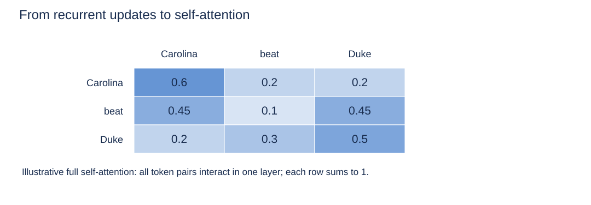
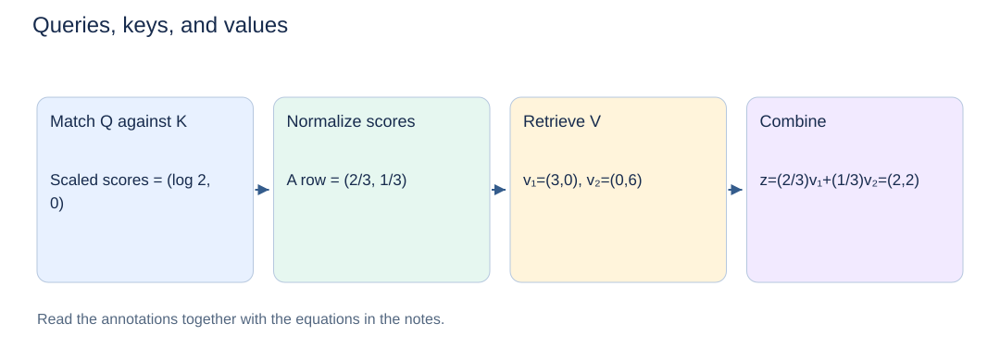
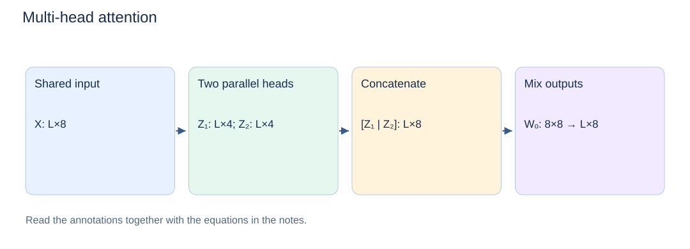

# 2.3 Attention & Transformers — Study Notes

**Provided Markdown:** [2.3_Attention_and_Transformers.md](2.3_Attention_and_Transformers.md). **Slides reviewed:** [COMP664_11_Attention_and_Transformers.pdf](COMP664_11_Attention_and_Transformers.pdf).

Starred entries preserve points and formulas from the provided Markdown; all teaching additions, examples, and source qualifications are unstarred. The provided Markdown is the available notes/transcript source; no separate verbatim transcript was found. Slide numbers refer to PDF page numbers, including title slides.

**Notation and prerequisites.** $L$ is sequence length, $d_{\mathrm{model}}$ the token-vector width, and $H$ the number of attention heads. $Q$, $K$, and $V$ are query, key, and value matrices. A transpose swaps matrix rows and columns; compatible inner dimensions are required for multiplication.

## From recurrent updates to self-attention

**Sources:** Attention & Transformers, slides 11–15 and 27; provided Markdown section “From recurrent updates to self-attention.”

★ In a recurrent model, information from the first position travels through $L-1$ state updates to reach the last position.

★ In full self-attention, the last position can attend directly to the first in a single layer.

★ Think of the tokens as nodes in a graph.

★ Full self-attention scores all ordered pairs of nodes, producing an $L\times L$ matrix for a sequence of length $L$.

★ These scores can be computed together with matrix operations, which map well to GPUs.

“Path length one” means one cross-token attention edge between two **visible** positions in one layer, not that an entire deep model has only one computation step. Attention can mix distant information directly, while an RNN passes information through intervening hidden states. Stacked Transformer layers still depend on preceding layers, and autoregressive generation still depends on previously generated tokens.

★ A Transformer takes a vector per token and returns a refined vector per token.

★ Context helps determine what the refined vector represents.

★ For example, surrounding words can establish that “Carolina” refers to a UNC basketball team.

★ In “The animal didn’t cross the street because it was too tired,” information from “animal” can help contextualize “it.”

The all-pairs score matrix has one row per querying position and one column per candidate source position. Unlike a fixed graph, its edge strengths depend on the input and the learned projections. The vector at a token's output is contextual: the same word can receive different vectors in different sentences. The pronoun examples illustrate possible contextual behavior, not a guarantee that a particular head always resolves reference correctly.

*Every query has an edge to every key in full self-attention; the displayed weights are illustrative.*

## Queries, keys, and values

**Sources:** Attention & Transformers, slides 16–26; provided Markdown section “Queries, keys, and values.”

★ Each token vector produces three learned projections.

★ The **query** represents what information the token is looking for.

★ The **key** represents what other queries can match against.

★ The **value** carries the information passed along when the token receives attention.

★ Using rows for tokens, let $X\in\mathbb R^{L\times d_{\mathrm{model}}}$.

★ For one attention head,

★ Supplied formula:

$$
Q=XW_Q
$$

★ Supplied formula:

$$
K=XW_K
$$

★ Supplied formula:

$$
V=XW_V.
$$

The projections have shapes $W_Q,W_K\in\mathbb R^{d_{\mathrm{model}}\times d_k}$ and $W_V\in\mathbb R^{d_{\mathrm{model}}\times d_v}$. Thus $QK^\top$ and $A$ are $L\times L$, and $Z$ is $L\times d_v$. Query and key widths must agree for their dot product, but value width can differ. “Query,” “key,” and “value” describe learned computational roles rather than manually labeled linguistic properties.

★ The query and key each have width $d_k$, while the value can have width $d_v$.

★ For query position $i$ and key position $j$, the raw score is $q_i^\top k_j$.

★ Scaled dot-product attention computes

★ Supplied formula:

$$
A=\operatorname{softmax}_{\mathrm{row}}\!\left(\frac{QK^\top}{\sqrt{d_k}}\right)
$$

★ Supplied formula:

$$
Z=AV.
$$

For one query with scaled scores $(\log2,0)$, softmax gives $(2/3,1/3)$. With value rows $(3,0)$ and $(0,6)$, the output is $(2,2)$. Notice that scores determine **where** to retrieve, while values determine **what** is retrieved.

★ Row $i$ of $A$ says how much the output at position $i$ uses each value vector.

★ The output row is $z_i=\sum_j A_{ij}v_j$.

★ Dividing by $\sqrt{d_k}$ controls how large the dot products tend to become as the key width grows, reducing softmax saturation.

★ In self-attention, all three projections come from the same sequence.

The scaling heuristic assumes roughly zero-mean, unit-variance, independent query and key components. The sum of $d_k$ products then has variance about $d_k$, so dividing by $\sqrt{d_k}$ keeps variance about one. Learned features need not satisfy these assumptions exactly. **Numerical slide check:** scaled scores $(2.1,0.5,1.8,-0.2)$ give probabilities approximately $(0.490,0.099,0.363,0.049)$; the slide's $(0.49,0.10,0.36,0.05)$ is consistent rounding in source-token order.

*Scores determine the retrieval weights; the weighted value vectors determine the resulting representation.*

## Multi-head attention

**Sources:** Attention & Transformers, slides 28–35; provided Markdown section “Multi-head attention.”

★ Different heads have their own query, key, and value projections.

★ This allows them to form different attention patterns over the same input.

★ A head may appear to track a relationship such as pronoun reference.

★ The patterns are learned from the training objective.

★ The layer concatenates the head outputs and applies an output projection $W_O$ to mix them and return to width $d_{\mathrm{model}}$:

★ Supplied formula:

$$
\operatorname{MultiHead}(X)
=\operatorname{Concat}(Z_1,\ldots,Z_H)W_O.
$$

Let $H$ be the number of heads. Each $Z_h$ has shape $L\times d_v$, so concatenation has shape $L\times(Hd_v)$, and $W_O\in\mathbb R^{Hd_v\times d_{\mathrm{model}}}$. The usual choice $Hd_v=d_{\mathrm{model}}$ makes $W_O$ square. The heads' parameters differ, while their input sequence is shared.

★ A common choice is $d_k=d_v=d_{\mathrm{model}}/H$.

★ With this convention, increasing the number of heads at a fixed model width narrows each head, so the combined projection widths stay the same.

For $d_{\mathrm{model}}=8$ and $H=2$, each query/key/value width can be 4. Two $L\times4$ outputs concatenate to $L\times8$, then the $8\times8$ output projection mixes their coordinates. The query projections across heads jointly have $H(d_{\mathrm{model}}d_k)=d_{\mathrm{model}}^2$ weights, likewise keys and values; adding the output projection gives $4d_{\mathrm{model}}^2$ weights, ignoring biases. At fixed width, projection parameter count stays roughly constant as head count changes, but explicit attention-weight storage grows with the number of heads. Linguistic interpretations of heads are hypotheses to test, not constraints imposed by the architecture.

*Separate heads produce narrower outputs, concatenate them, and mix them back to model width.*

