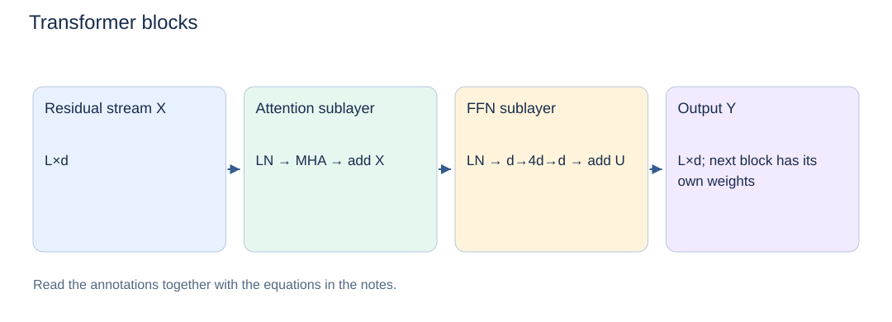
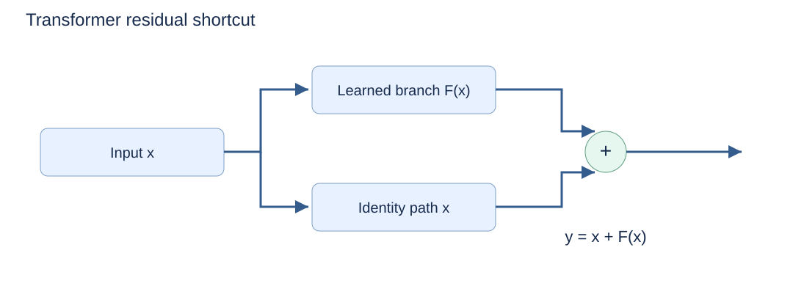
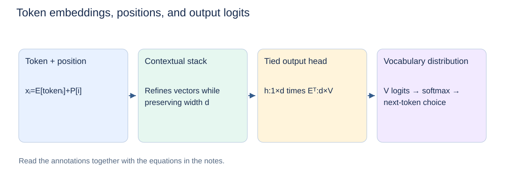
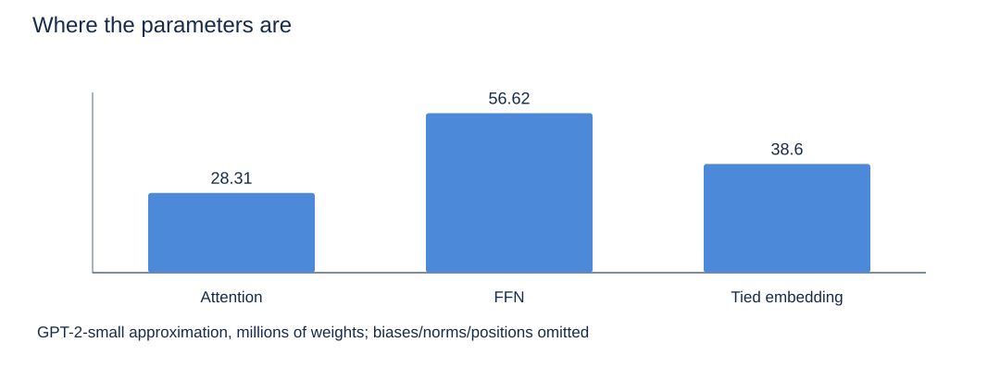
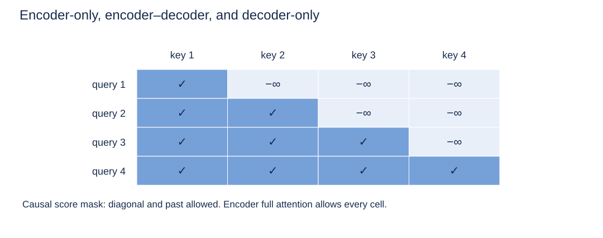
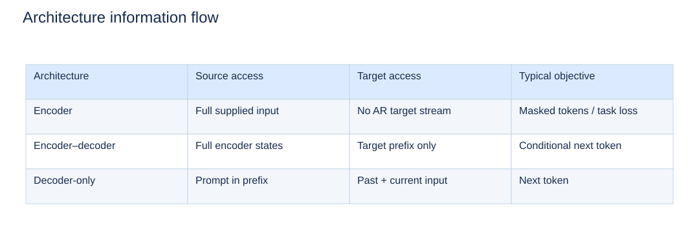

# 2.4 Transformer Architectures — Study Notes

**Provided Markdown:** [2.4_Transformer_Architectures.md](2.4_Transformer_Architectures.md). **Slides reviewed:** [COMP664_12_TransformerArchitectures.pdf](COMP664_12_TransformerArchitectures.pdf).

Starred entries preserve points and formulas from the provided Markdown; all teaching additions, examples, and source qualifications are unstarred. The provided Markdown is the available notes/transcript source; no separate verbatim transcript was found. Slide numbers refer to PDF page numbers, including title slides.

**Notation and prerequisites.** $d=d_{\mathrm{model}}$ is model width, $d_{\mathrm{ff}}$ is FFN hidden width, $N$ is the number of blocks, and $V$ is vocabulary size in parameter-count formulas. LN means LayerNorm; MHA means multi-head attention. These block counts are distinct from batch sizes in earlier lectures.

## Transformer blocks

**Sources:** Attention & Transformers, slides 36–39 and 58; Transformer Architectures, slide 4; provided Markdown section “Transformer blocks.”

★ A Transformer stacks blocks that alternately mix information across tokens and transform each token's representation.

1. ★ **Multi-head attention** mixes information across positions.
2. ★ **Position-wise feed-forward network** applies the same learned nonlinear transformation independently to every position. A common design expands each vector from $d_{\mathrm{model}}$ to $4d_{\mathrm{model}}$, applies an activation, and projects it back to $d_{\mathrm{model}}$. The expanded layer gives the network room to represent different features of each contextualized token.

In row notation a standard position-wise FFN is $\operatorname{FFN}(X)=\phi(XW_1+b_1)W_2+b_2$, with $W_1:d\times d_{\mathrm{ff}}$ and $W_2:d_{\mathrm{ff}}\times d$. The same function applies to every row; it mixes feature coordinates within a token, while attention mixes information across tokens. The original and other standard designs often use $d_{\mathrm{ff}}=4d$, but gated FFNs use different layouts and counts.

★ Both sublayers use residual connections and normalization.

★ With post-normalization, a sublayer takes the form $\operatorname{LN}(x+F(x))$.

★ With pre-normalization, it takes the form $x+F(\operatorname{LN}(x))$.

★ Layer normalization acts across the features of each token vector and can learn a scale and bias.

★ Each block has its own projection and feed-forward weights, while the feed-forward weights within a block are shared across positions.

A pre-normalized block can be written $U=X+\operatorname{MHA}(\operatorname{LN}_1(X))$, $Y=U+\operatorname{FFN}(\operatorname{LN}_2(U))$. The two LayerNorms generally have separate learned parameters. In post-normalization, each normalization follows its residual addition instead. Compatible shapes are required at each addition. LayerNorm's statistics are per token across its features, so other tokens in a batch do not affect those statistics.

*Attention mixes positions, the FFN transforms features, and both sublayers preserve residual routes.*

*Each sublayer preserves a skip route and adds a learned change to the residual stream.*

## Token embeddings, positions, and output logits

**Sources:** Attention & Transformers, slides 43–48 and 57; Word Embeddings, slides 31–34; provided Markdown section “Token embeddings, positions, and output logits.”

★ A token embedding table provides one vector per vocabulary item.

★ Attention by itself is equivariant to a permutation of the input rows when it has no position information or position-dependent mask.

★ To represent order, a model can add a learned position vector $p_i$ to the token embedding $e(w_i)$ at position $i$.

★ A token such as “Carolina” then has a different initial representation in position one than in position three.

Without positional information or a position-dependent mask, self-attention is **permutation equivariant**. If $P$ permutes the input rows, projected queries, keys, and values also permute. Scores become $PSP^\top$, row softmax becomes $PAP^\top$, and the output is $PAV=PZ$. Outputs are permuted, not numerically unchanged at their original row indices. This refines the informal “same outputs” wording on slide 45.

★ To predict a token, the model uses an output projection, sometimes called **unembedding**, to map a final hidden vector to one logit per vocabulary item.

★ Some models tie the output weights to the input embedding weights, using the embedding matrix transposed for the output projection.

★ Embeddings can be updated through backpropagation.

Adding $p_i$ makes a token's initial vector depend on its position. Learned absolute embeddings are one approach; the lecture's formula is not a requirement that every Transformer represent positions by addition. For a row hidden vector $h\in\mathbb R^{1\times d}$ and embedding table $E\in\mathbb R^{V\times d}$, tied unembedding computes logits $s=hE^\top\in\mathbb R^{1\times V}$. It is a learned scoring operation, not the inverse of embedding lookup.

★ Tokenization also affects how many positions an input occupies.

★ With subword tokenization, a long word can occupy several positions, and comparable text in different languages can have different token counts.

★ The lecture used morphologically rich languages such as Turkish and Icelandic to illustrate why token count and word count can behave differently.

Weight tying means gradients from input lookup and output prediction accumulate into the same table. Source text is measured in tokenizer-dependent tokens: a word can require several positions, and token counts across languages need not match word counts. Any example segmentation must be treated as illustrative unless a particular tokenizer is specified.

*Follow token-plus-position vectors into contextual states and then vocabulary scores.*

## Where the parameters are

**Sources:** Attention & Transformers, slides 38–41; provided Markdown section “Where the parameters are.”

★ For a standard block with model width $d$ and feed-forward width $4d$, the attention projections contribute about $4d^2$ weights, and the feed-forward projections contribute about $8d^2$.

★ With $N$ blocks and one tied token embedding and output matrix for a vocabulary of size $V$, an approximate count is $12Nd^2+Vd$, before adding position embeddings, normalization parameters, and biases.

★ The block terms grow with depth.

★ The vocabulary term depends on vocabulary size and width.

★ This is why embeddings can be a substantial fraction of a smaller model and account for a smaller share as more blocks are added.

For standard attention with $H$ heads of width $d/H$, each family of query projections has $H\cdot d\cdot(d/H)=d^2$ weights; key and value projections contribute another $2d^2$, and $W_O$ contributes $d^2$. A two-matrix FFN of widths $d\to4d\to d$ adds $4d^2+4d^2=8d^2$. Thus FFNs hold about two-thirds of **block matrix weights**, not necessarily two-thirds of every model's total parameters.

Using the lecture's GPT-2-small example, $N=12$, $d=768$, and $V=50{,}257$ give $12Nd^2=84{,}934{,}656$ and $Vd=38{,}597{,}376$, totaling $123{,}532{,}032$ before the omitted terms. Untying input and output matrices adds another $Vd$; learned absolute positions of maximum length $T$ add $Td$. Gated FFNs, grouped KV heads, cross-attention, and other architecture changes require different counts. Keep $N$ for block count here distinct from the number of training examples used in earlier lectures.

*For this example, FFN matrices hold twice the block weights of attention; embeddings add a separate term.*

## Encoder-only, encoder–decoder, and decoder-only

**Sources:** Transformer Architectures, slides 3–23; Attention & Transformers, slides 50–56 and 60; provided Markdown section “Encoder-only, encoder–decoder, and decoder-only.”

| Architecture | Attention pattern | Main use | Lecture example |
| --- | --- | --- | --- |
| ★ Encoder-only | Bidirectional self-attention over the supplied input | Contextual representations for tasks such as classification | BERT |
| ★ Encoder–decoder | Bidirectional encoder self-attention, causal decoder self-attention, and decoder cross-attention to encoder outputs | Conditional generation such as translation and summarization | T5 |
| ★ Decoder-only | Causal self-attention over the token prefix | Autoregressive generation | GPT |

★ **Encoder-only.** BERT stands for *Bidirectional Encoder Representations from Transformers*.

★ Its pretraining used masked language modeling, in which selected tokens are hidden or corrupted and predicted using the surrounding text on both sides.

★ Original BERT also used next-sentence prediction, which distinguished actual neighboring sentences from randomly paired ones.

★ The lecture noted that later models have used masked language modeling without the next-sentence objective.

★ For downstream tasks such as sentiment or topic classification, a small task-specific head can use the pretrained encoder's contextual representations.

★ Fine-tuning adapts the pretrained model to labeled examples for the target task.

A bidirectional encoder can use the supplied tokens on both sides of a position. Masked language modeling predicts selected corrupted positions; this objective differs from causal next-token prediction. For classification, a learned head can consume a designated sequence representation. **Fine-tuning clarification:** slide 11 says only the added final layer is trained, but that describes a frozen encoder with a trained head (often called a linear probe). Fine-tuning may update the pretrained encoder as well; the source notes correctly allow adaptation of the pretrained model.

★ **Encoder–decoder.** The encoder reads the full source sequence.

★ At each target position, the decoder attends to the available target prefix and can use cross-attention to retrieve information from the source.

★ In cross-attention, the queries come from the decoder and the keys and values come from the encoder.

★ T5, the *Text-to-Text Transfer Transformer*, casts multiple tasks into a shared text-to-text format.

★ A task prefix can specify “translate English to German” or “summarize,” followed by the input text.

★ Even a classification task can produce a text label as its output.

★ The same model can train across these tasks, with the task indicated by the input.

An encoder–decoder has a separate source representation and target stream. Decoder cross-attention uses $Q$ from decoder states and $K,V$ from encoder states, giving a target-length by source-length attention matrix. The target self-attention remains causal while cross-attention can read the full source. A text-to-text format unifies task inputs and outputs; it does not alone guarantee successful zero-shot generalization to every new task. T5 is the lecture's task-prefix example, while BART is another encoder–decoder example using reconstruction of corrupted text.

★ **Decoder-only.** A causal mask lets position $i$ attend to positions $j\le i$.

★ Before the row-wise softmax, scores with $j>i$ are set to $-\infty$, so their attention weights become zero.

★ During training, the shifted targets are already known, so the model can compute next-token predictions for all positions in a sequence together.

★ During generation, the model selects tokens sequentially because each newly selected token extends the prefix for the next prediction.

★ The entire supplied prompt is available as context when generating the first response token.

For a causal decoder, use $M_{ij}=0$ for $j\le i$ and $M_{ij}=-\infty$ for $j>i$, then $A=\operatorname{softmax}_{\mathrm{row}}(QK^\top/\sqrt{d_k}+M)$. Row $i$ can see token $i$ while predicting token $i+1$, so the diagonal is allowed without revealing the target. All known training positions are evaluated together, but layers still execute in order. **Slide qualification:** slide 23's claim of no vanishing or exploding gradients is too absolute; direct token interactions and residual/normalization components improve training but do not remove every gradient instability.

*Cells above the diagonal are masked before softmax, so future tokens receive zero attention.*

*Compare where information is allowed to flow, rather than just the model names.*

