# 2.5 Large Language Models — Study Notes

**Provided Markdown:** [2.5_Large_Language_Models.md](2.5_Large_Language_Models.md). **Slides reviewed:** [COMP664_13_LLMs.pdf](COMP664_13_LLMs.pdf), [COMP664_14_MakingLLMsEfficient.pdf](COMP664_14_MakingLLMsEfficient.pdf).

Starred entries preserve points and formulas from the provided Markdown; all teaching additions, examples, and source qualifications are unstarred. The provided Markdown is the available notes/transcript source; no separate verbatim transcript was found. Slide numbers refer to PDF page numbers, including title slides.

**Notation and prerequisites.** A language model returns a distribution over the next token given a prefix. $\theta$ denotes its parameters. A FLOP is one floating-point operation; FLOP/s is a rate. Decimal GB and TB use powers of 1000; MiB uses $2^{20}$ bytes.

## Autoregressive pretraining and generation

**Sources:** Large Language Models, slides 3–18 and 20–25; source section “Autoregressive pretraining and generation”; provided Markdown section “Autoregressive pretraining and generation.”

★ A decoder-only Transformer can learn from raw text by using each token as the prediction target for the prefix that precedes it.

★ Training on many sequences builds a shared model of next-token probabilities.

★ At inference time, an instruction, document, or conversation history can serve as the initial prefix.

★ The resulting continuation can function as an answer, summary, or translation depending on the prompt.

For tokens $x_1,\ldots,x_T$, pretraining minimizes $\mathcal L(\theta)=-\sum_{t=1}^{T-1}\log p_\theta(x_{t+1}\mid x_{1:t})$, with boundary and masking conventions chosen for the dataset. The targets come from text, so this is self-supervised learning. Text filtering, deduplication, and corpus composition affect what the model learns; next-token accuracy is not a guarantee of factual truth.

★ The lecture distinguished a model's token-by-token generation from a system's use of several model calls.

★ A system can first generate a plan, then draft, critique, or revise a response.

★ Each generated intermediate result can become context for a later call.

A prompt changes the conditioning context and activations. In-context learning uses instructions or examples in that context without a gradient update to model parameters. Fine-tuning instead changes parameters. A larger system may call the same model repeatedly, passing one call's output into another; this differs from a single call's token-by-token continuation. The source's plan–draft–critique workflow is supported by its description, but is not separately detailed in the slide deck.

**Scope check.** Slide 4 uses “ChatGPT” and 175 billion parameters as an illustration; the study notes do not treat that as an architecture specification for every model or service with that name. Claims about product capabilities or current model sizes are outside the evidence established by these lecture files.

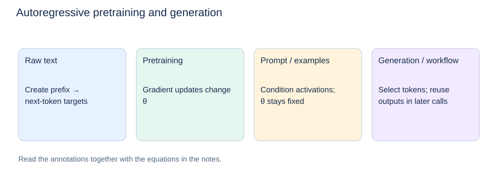

*Parameter learning, context conditioning, and a multi-call workflow operate at different stages.*

## Empirical scaling laws and emergent abilities

**Sources:** Large Language Models, slides 27–35; provided Markdown section “Empirical scaling laws and emergent abilities.”

★ The lecture discussed three factors that affect language-model test loss:

★ **Model size**, measured in trainable parameters.

★ **Training data**, often measured in tokens.

★ **Training compute**, measured in operations such as FLOPs.

The lecture's slide 28 explicitly excludes embeddings from its parameter measure, whereas your phrase “trainable parameters” is broader. Specify the convention when reproducing a scaling plot. Compute is measured in **FLOPs** (operations); FLOP/s measures hardware throughput. A fixed budget requires trading model size against training tokens and optimization choices rather than assuming all can increase freely.

★ Scaling laws summarize empirical relationships between these factors and held-out loss.

★ Over observed ranges, loss can follow approximate power-law trends as model size, training data, or compute grows.

★ Measurements from smaller training runs can help estimate the loss of larger runs and guide compute allocation.

★ The relationships are fitted over particular ranges, so extrapolation carries uncertainty.

A schematic power law is $L(N)=L_\infty+aN^{-\alpha}$ for positive $a,\alpha$ over a measured regime. Then $\log(L-L_\infty)=\log a-\alpha\log N$ is linear in $\log N$. This is an illustrative form, not a set of fitted course constants. Similar forms can describe data or compute scaling under particular assumptions; these quantities cannot always be varied independently in a real training run.

★ Some benchmarks show a different pattern from aggregate loss.

★ Performance on a task may stay near chance for smaller models and then improve sharply as scale increases.

★ The lecture described this as an apparent *emergent ability* and raised the possibility that some tasks require several prerequisite abilities to work together.

★ The observation depends on the task and how its performance is measured.

For illustration, halving $N^{-1/2}$ requires quadrupling $N$. A thresholded benchmark can show a sudden jump even if underlying prediction probabilities improve smoothly, so apparent emergence depends on the metric as well as the system. Neither a smooth loss fit nor a sharp benchmark transition proves a universal law of reasoning ability.

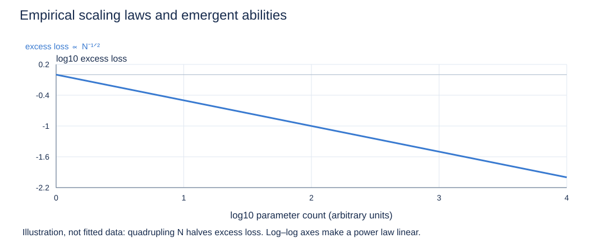

*A power law becomes linear on log–log axes; this curve is illustrative rather than fitted data.*

## Long-context attention

**Sources:** Large Language Models, slides 38–40; Making LLMs Efficient, slides 4–29; source section “Long-context attention”; provided Markdown section “Long-context attention.”

★ Full attention has a quadratic cost in sequence length because every query position is scored against every key position.

★ For one head, $L=1{,}000$ gives one million score entries and $L=10{,}000$ gives one hundred million.

★ A million-token sequence would give a trillion entries if the full dense matrix were formed.

★ A causal mask removes future-token interactions but still permits a quadratic number of past-token pairs.

With query/key width $d_k$ and value width $d_v$, dense attention costs $O(L^2d_k)$ for $QK^\top$ and $O(L^2d_v)$ for the weighted values, plus projection costs. Explicitly materializing the score matrix needs $O(L^2)$ entries per head. Causal attention has $L(L+1)/2$ allowed pairs, which is still quadratic. Optimized exact algorithms can avoid storing the whole matrix while retaining quadratic arithmetic; arithmetic cost and peak memory are different claims.

★ The lecture discussed sparse attention, which restricts the pairs that can interact, and approximate or linear attention, which changes the computation used to combine token information.

★ Retrieval-augmented generation addresses a related context problem by retrieving relevant passages and putting them into the model's input, so the model can attend to those passages without processing the entire collection at once.

A local sparse window of width $w$ uses about $Lw$ pairs. Approximate/linear methods change the attention formulation, and generally are not just a reassociation of ordinary row-softmax attention. Retrieval selects external passages to include in the prompt; it reduces the collection the model must read at once but does not change dense attention's complexity for the resulting prompt. Retrieval-augmented generation is described in the source notes; it is not explicitly developed in these slide decks.

For generation, the efficiency lecture separates **prefill** (process a known prompt) from **decode** (advance one generated position). A KV cache saves earlier keys and values per layer, avoiding their recomputation. With $n_\ell$ layers, $n_{\mathrm{kv}}$ KV heads, head width $d_h$, context length $L$, batch size $B$, and $b$ bytes per stored scalar, cache bytes are $2n_\ell n_{\mathrm{kv}}d_hLBb$, assuming equal key/value widths. The factor two counts keys and values. Caching reduces recomputation but each full-attention decode step still reads earlier keys/values.

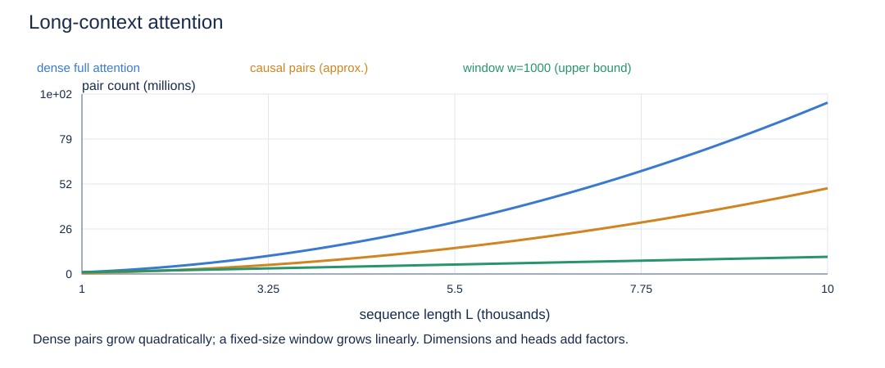

*Dense and causal pair counts grow quadratically, while a fixed-width local window grows linearly.*

## Interpretability, ablation, and trust

**Sources:** Large Language Models, slides 37 and 41–42; Attention & Transformers, slide 61; source section “Interpretability, ablation, and trust”; provided Markdown section “Interpretability, ablation, and trust.”

★ Knowing the architecture and training objective leaves open the question of how a trained model produces a particular answer.

★ Interpretability experiments can inspect internal activations and attention patterns or intervene in the computation.

★ An **ablation** can remove an attention head and measure how predictions or task performance change.

★ The effect is evidence about that component's role in the tested setting.

An attention map is an observation about an intermediate computation; it is not by itself proof of why a final answer occurred. An ablation is an intervention: remove or alter a component and compare behavior against a baseline under otherwise comparable evaluation conditions. For example, a drop in a pronoun-resolution test after ablating a head is evidence for that head's role in that setting, not proof that it is exclusively a pronoun head.

A small effect can reflect redundancy rather than irrelevance; a large effect can reflect nonspecific damage. Use targeted tasks, appropriate controls, and multiple examples. The lecture's induction-head example illustrates a more specific mechanism, copying a continuation in a repeated pattern $[A][B]\ldots[A]\to[B]$, rather than concluding that every computation is understood.

★ The classroom discussion connected interpretability to trust in public-facing or safety-relevant applications.

★ It considered two kinds of evidence: an explanation of how a system reached a decision, and a record of how it behaves under testing and oversight.

★ A system can perform well on familiar tasks while still failing under unfamiliar conditions.

★ Repeated success can also lead users to rely on a system before they have evidence that it generalizes to the setting where they want to use it.

The source notes' discussion of trust and oversight goes beyond the slide deck's short interpretability prompts. Preserve the distinction between an explanatory hypothesis, measured behavior on a test distribution, and reliability in a new setting. No transcript timestamps or additional classroom dialogue are available in these folders to resolve that discussion more precisely.

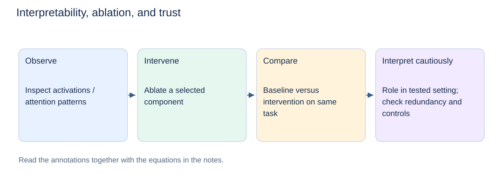

*Move from observing a pattern to intervening and comparing controlled outcomes.*

## Generation throughput and memory bandwidth

**Additional material from slides:** Making LLMs Efficient, slides 4–7.

**Latency** is the time one request waits; **throughput** is total tokens processed per second. Prefill commonly uses many prompt positions in one pass, while ordinary decoding advances each sequence one token per pass. A useful simplified lower bound is $t\gtrsim\max(\text{bytes transferred}/\text{bandwidth},\text{FLOPs}/\text{compute rate})$. Actual time also includes communication, scheduling, attention, and kernel overhead.

The lecture's illustrative 70-billion-weight model occupies roughly $140$ GB at two bytes per weight. Reading those weights at an aggregate $6.7$ TB/s takes about $20.9$ ms; a rough matrix-operation count of $2\cdot70$ billion operations at $2{,}000$ TFLOP/s is about $0.07$ ms. These are idealized assumptions for the slide's setup, not measured universal decoding times. At small batch size, reading weights can dominate the arithmetic.

Batching reuses a weight read across several active sequences and can raise aggregate throughput. Each sequence still needs its own state and KV cache, so memory use and cache traffic grow. The slide's “16 users” example does not promise unchanged latency as batch size grows. Continuous batching admits new requests when prior ones finish, reducing idle slots compared with waiting for a whole static batch to finish.

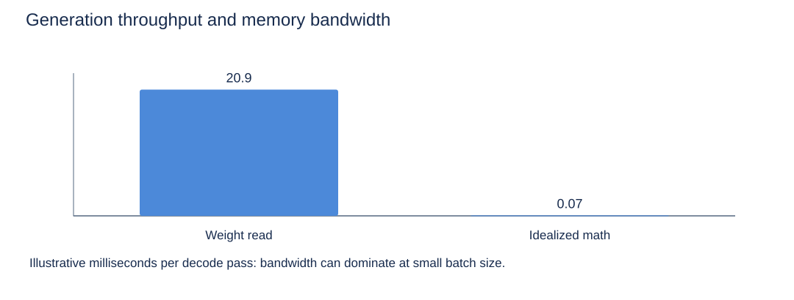

*In the slide’s idealized setup, reading weights costs much more time than the matrix arithmetic.*

## Reducing KV cache memory

**Additional material from slides:** Making LLMs Efficient, slides 15–29.

The cache formula shows independent ways to reduce memory: fewer KV heads, shorter retained history, fewer bytes per number, or a compressed latent representation. Standard **multi-head attention (MHA)** has one KV head per query head. **Grouped-query attention (GQA)** shares a KV head among a group of query heads; **multi-query attention (MQA)** uses one KV head for all query heads. Queries remain distinct, so shared keys and values do not force identical attention weights.

For 8 query heads, 8 KV heads use the baseline cache, 2 KV heads use one-quarter as much, and 1 KV head uses one-eighth, assuming identical widths and numerical precision. For example, with 32 layers, 8 KV heads, width 128, 4096 tokens, batch one, and 2 bytes per scalar, the cache is $2\cdot32\cdot8\cdot128\cdot4096\cdot2=536{,}870{,}912$ bytes, or 512 MiB. This is cache memory alone.

**Multi-head latent attention (MLA)** caches a lower-dimensional summary $c_t=W_{\mathrm{down}}h_t$, with key/value information recovered or algebraically incorporated into attention using learned projections. Actual MLA also handles positional information; the lecture's summary-plus-position count is model-specific. It trades a smaller stored representation against different computations.

**Sliding-window attention** retains only a bounded recent context in windowed layers. Information can propagate farther through stacked layers, but the window removes direct access to distant cached tokens. **Paging** allocates KV storage in small blocks and uses block tables to locate them, reducing unused allocation and fragmentation. Paging does not itself reduce the number of scalars mathematically required for a full cache. Cache quantization instead reduces bytes per scalar and may affect numerical accuracy.

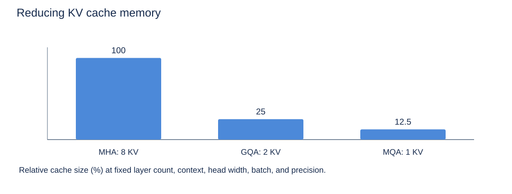

*Sharing fewer KV heads reduces cache size without reducing the number of query heads.*

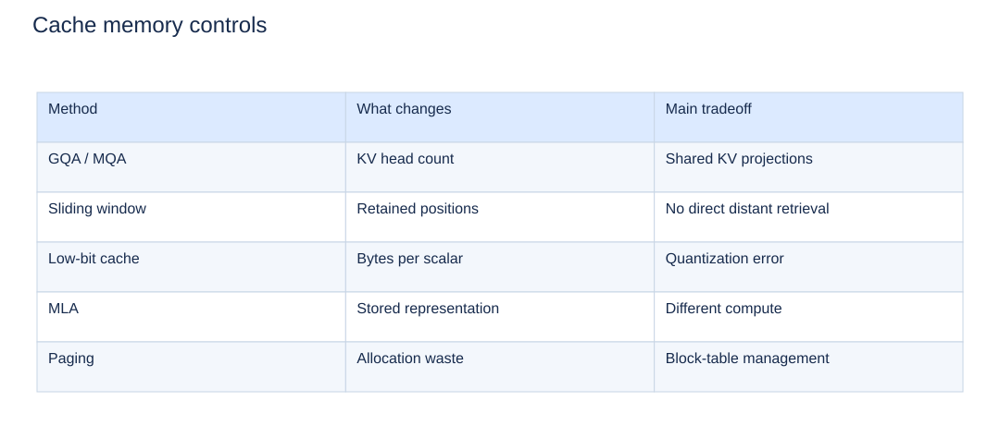

*These techniques reduce different terms or overheads; they are not interchangeable.*

## Quantization, LoRA, and QLoRA

**Additional material from slides:** Making LLMs Efficient, slides 31–33.

**Quantization** approximates real-valued weights or activations using a finite set of codes. A simple uniform affine scheme uses $x\approx s(q-z)$, where $q$ is an integer code, $s>0$ is a scale, and $z$ is a zero point. Rounding, clipping, outliers, and group sizes determine the error. Four bits give 16 codes; eight bits give 256. This uniform illustration is distinct from nonuniform formats such as NF4.

Ignoring scales and other overhead, 70 billion weights require 140 GB at 16 bits, 70 GB at 8 bits, and 35 GB at 4 bits. Quantizing weights does not automatically quantize activations, optimizer state, or the KV cache. Outliers can stretch a shared quantization range and leave fewer useful levels for typical values; per-group scales can reduce that effect. Accuracy and realized speed depend on kernels, formats, and workload.

**LoRA** freezes $W_0\in\mathbb R^{d\times k}$ and learns a low-rank correction $BA$, where $B\in\mathbb R^{d\times r}$ and $A\in\mathbb R^{r\times k}$, with $r\ll\min(d,k)$. The output is $W_0x+BAx$ (some conventions include a scaling coefficient). The adapter has $r(d+k)$ parameters instead of $dk$. At $d=k=4096$, $r=16$, that is $131{,}072$ versus $16{,}777{,}216$, or $0.78125\%$.

**QLoRA** stores the frozen base model in a low-bit format while training adapters at higher precision. The frozen base still participates in forward computation and input-gradient propagation; “frozen” means its weights do not receive optimizer updates. Memory savings also depend on activations, optimizer state, and the specific quantized representation, not just parameter count.

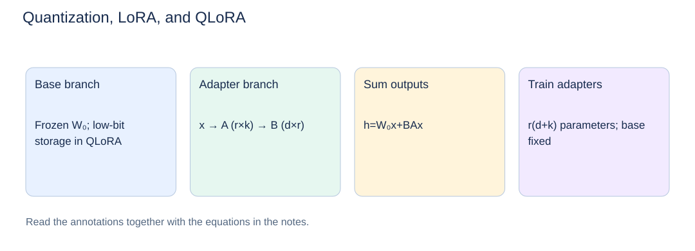

*Keep the base fixed, train a small adapter, and combine their outputs; low-bit storage reduces base memory.*

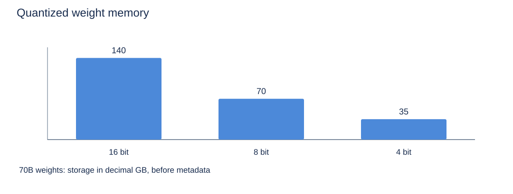

*Halving the bits per weight halves raw weight storage; other memory costs remain.*

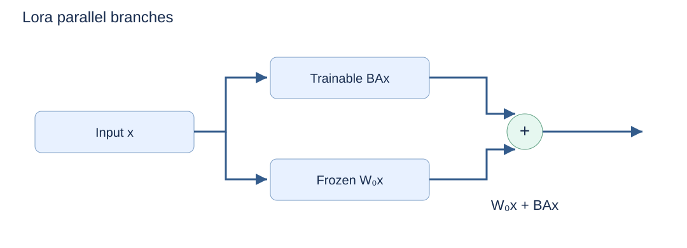

*LoRA adds the adapter output to the frozen base output; it does not feed one branch into the other.*

## Speculative decoding and exact sampling

**Additional material from slides:** Making LLMs Efficient, slides 35–42.

A fast draft model proposes several tokens autoregressively. A larger target model evaluates the proposed prefix positions together using a causal pass. For greedy decoding, keep the consecutive draft tokens that match the target's greedy choices, replace the first mismatch with the target's choice, and discard the dependent draft suffix. If all drafts match, the target can supply an additional next token. With consistent implementation and tie handling, this preserves the target's greedy output.

For stochastic decoding, naive acceptance would change the output distribution. Let $q(x)$ be the draft distribution and $p(x)$ the target distribution at the same accepted prefix. Accept a proposed $x\sim q$ with probability $a(x)=\min(1,p(x)/q(x))$; the ratio is needed only for proposed tokens, for which $q(x)>0$. At the first rejection, sample from the normalized residual $r(x)=\max(0,p(x)-q(x))/Z$, where $Z=\sum_x\max(0,p(x)-q(x))$. Rejecting also discards later dependent guesses. If $Z=0$, the distributions coincide and rejection has probability zero.

The accepted mass at $x$ is $q(x)a(x)=\min(p(x),q(x))$. Total rejection probability is $1-\sum_x\min(p(x),q(x))=Z$, so the residual contributes $Zr(x)=\max(0,p(x)-q(x))$. Adding yields exactly $p(x)$. For $p=(0.6,0.4)$ and $q=(0.3,0.7)$, accepted mass is $(0.3,0.4)$ and residual mass is $(0.3,0)$, summing to the target. Exactness assumes the actual draft/target distributions used for sampling are those in the acceptance correction.

With approximately constant independent conditional acceptance chance $\alpha$ and $\gamma$ drafts per round, the simplified expected tokens per target pass is $E=1+\alpha+\cdots+\alpha^\gamma=(1-\alpha^{\gamma+1})/(1-\alpha)$ for $\alpha\ne1$; at $\alpha=1$, $E=\gamma+1$. A simplified speedup is $E/(1+\gamma c)$, where $c$ is one draft-pass cost divided by one target-pass cost. With $\alpha=0.8$, $\gamma=4$, and $c=0.05$, $E=3.3616$ and the estimate is about $2.80$. Real acceptance events and runtimes need not satisfy this idealization.

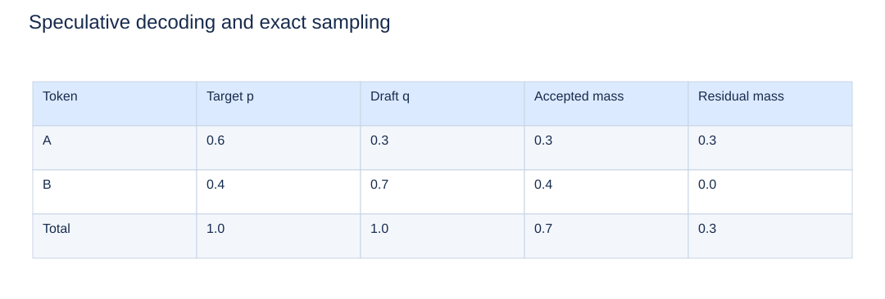

*Accepted mass plus residual mass equals the target probability for each token.*

